# One photo, 72 films

The same RAW from a Canon EOS M, developed by M-Film with every film it knows (half resolution here,
downsized for the page). Colour from [Film-Luts](https://github.com/YahiaAngelo/Film-Luts) where the film has a LUT, from
M-Film's own model otherwise; grain, halation and softness are modelled per film.

[← back](README.md) · [ภาษาไทย](README.th.md)

## Colour negative · 25

<table>
<tr><td width="33%"><a href="docs/films/portra400.jpg">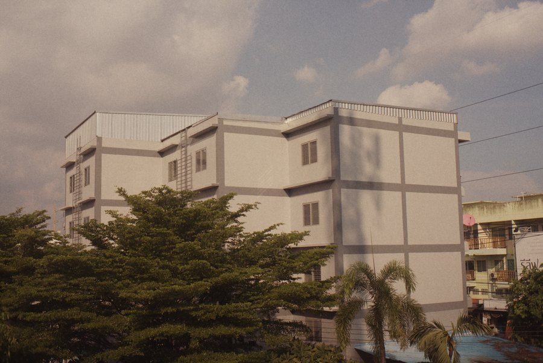</a> <b>Kodak Portra 400</b> ISO 400 · C-41 · Soft warm skin, gentle highlights</td><td width="33%"> <b>Kodak Ektar 100</b> ISO 100 · C-41 · Punchy colour, ultra fine grain</td><td width="33%"><a href="docs/films/gold200.jpg">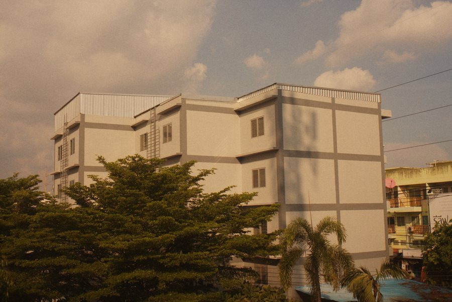</a> <b>Kodak Gold 200</b> ISO 200 · C-41 · Golden hour, all day long</td></tr>
<tr><td width="33%"><a href="docs/films/superia400.jpg">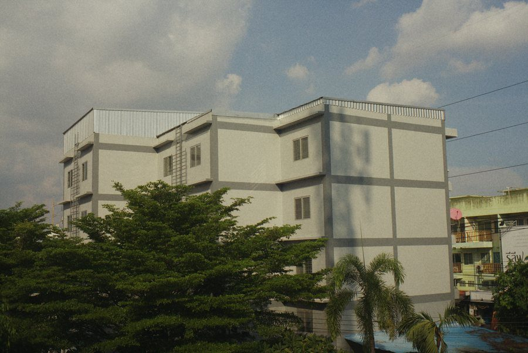</a> <b>Fujicolor Superia 400</b> ISO 400 · C-41 · Green shadows, everyday snaps</td><td width="33%"> <b>Kodak Portra 160</b> ISO 160 · C-41 · Fine grain, natural skin tones</td><td width="33%"> <b>Kodak Portra 800</b> ISO 800 · C-41 · Low light portraits, warm grain</td></tr>
<tr><td width="33%"> <b>Kodak Portra 160NC</b> ISO 160 · C-41 · Natural colour, soft contrast</td><td width="33%"> <b>Kodak Portra 160VC</b> ISO 160 · C-41 · Vivid colour for portraits</td><td width="33%"><a href="docs/films/portra400nc.jpg">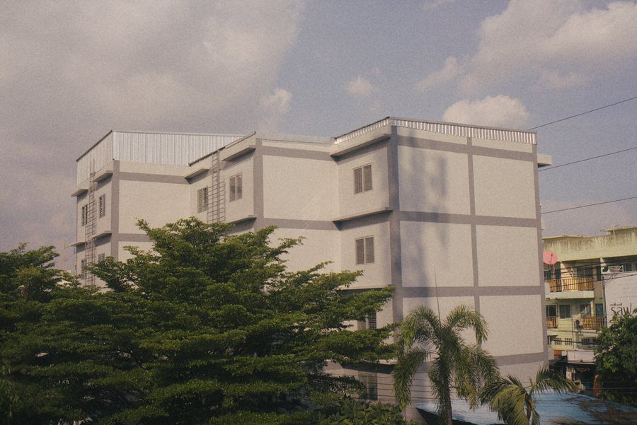</a> <b>Kodak Portra 400NC</b> ISO 400 · C-41 · Neutral skin, quiet colour</td></tr>
<tr><td width="33%"> <b>Kodak Portra 400VC</b> ISO 400 · C-41 · More colour, same skin tones</td><td width="33%"><a href="docs/films/portra400uc.jpg">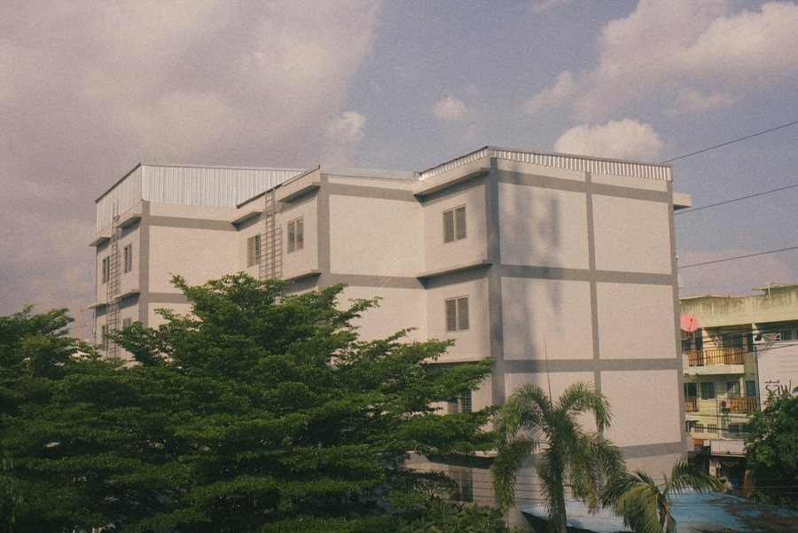</a> <b>Kodak Portra 400UC</b> ISO 400 · C-41 · Ultra colour, punchy everyday</td><td width="33%"><a href="docs/films/elite200.jpg">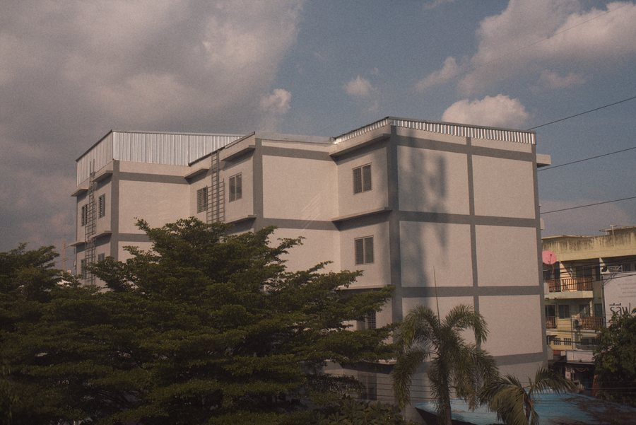</a> <b>Kodak Elite Color 200</b> ISO 200 · C-41 · Bright consumer colour</td></tr>
<tr><td width="33%"> <b>Kodak Elite Color 400</b> ISO 400 · C-41 · Everyday colour, more speed</td><td width="33%"> <b>Fujifilm Pro 160C</b> ISO 160 · C-41 · Crisp colour, cool and clean</td><td width="33%"> <b>Fujifilm Pro 400H</b> ISO 400 · C-41 · Airy pastels, fourth colour layer</td></tr>
<tr><td width="33%"> <b>Fujifilm Pro 800Z</b> ISO 800 · C-41 · Night portraits, soft palette</td><td width="33%"> <b>Fujifilm Reala 100</b> ISO 100 · C-41 · True-to-life colour, fine grain</td><td width="33%"> <b>Fujifilm Superia 100</b> ISO 100 · C-41 · Clean daylight colour</td></tr>
<tr><td width="33%"> <b>Fujifilm Superia 200</b> ISO 200 · C-41 · Fuji greens, everyday snaps</td><td width="33%"> <b>Fujifilm Superia 800</b> ISO 800 · C-41 · Indoor speed, Fuji colour</td><td width="33%"> <b>Fujifilm Superia 1600</b> ISO 1600 · C-41 · Night snaps, bold grain</td></tr>
<tr><td width="33%"> <b>Fujifilm X-TRA 800</b> ISO 800 · C-41 · Fast all-rounder, cool shadows</td><td width="33%"> <b>Agfa Vista 200</b> ISO 200 · C-41 · Warm reds, holiday colour</td><td width="33%"><a href="docs/films/ultra100.jpg">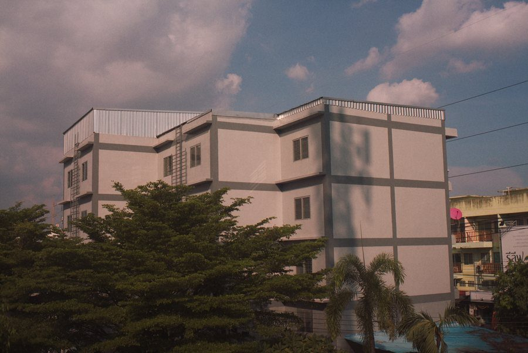</a> <b>Agfa Ultra 100</b> ISO 100 · C-41 · Saturated, punchy Agfa colour</td></tr>
<tr><td width="33%"><a href="docs/films/redscale100.jpg">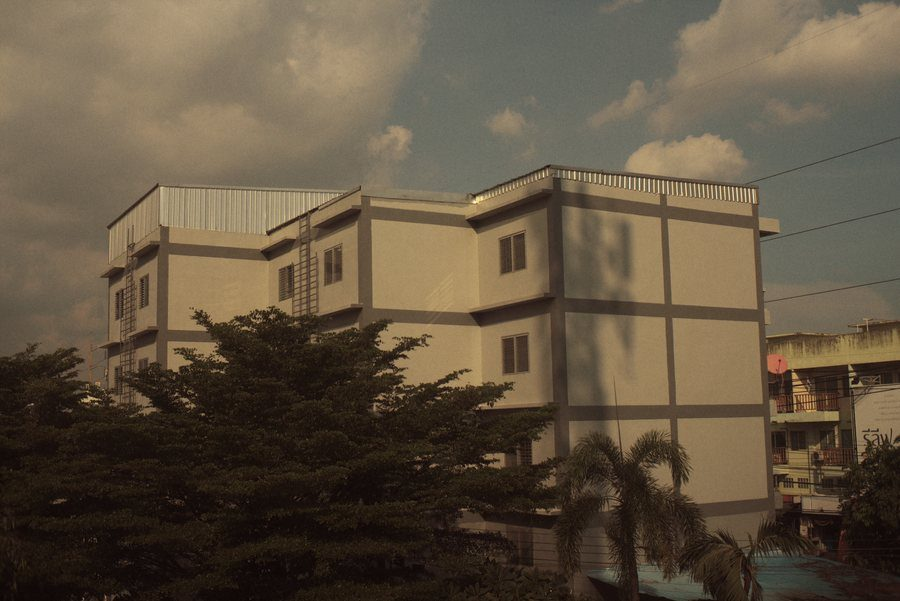</a> <b>Lomography Redscale 100</b> ISO 100 · C-41 · Shot through the back: red-orange</td></tr>
</table>

## Slide and cross-processed · 19

<table>
<tr><td width="33%"> <b>Fujichrome Velvia 50</b> ISO 50 · E-6 · Vivid slide film, hard contrast</td><td width="33%"> <b>Fujifilm Velvia 100</b> ISO 100 · E-6 · Rich colour, softer than the 50</td><td width="33%"><a href="docs/films/provia100f.jpg">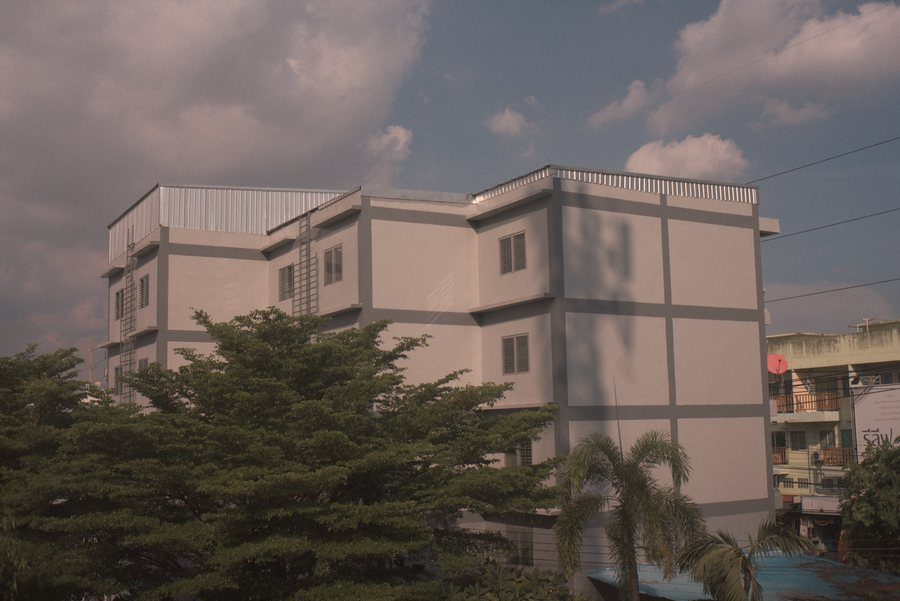</a> <b>Fujifilm Provia 100F</b> ISO 100 · E-6 · Neutral slide, faithful colour</td></tr>
<tr><td width="33%"><a href="docs/films/provia400f.jpg">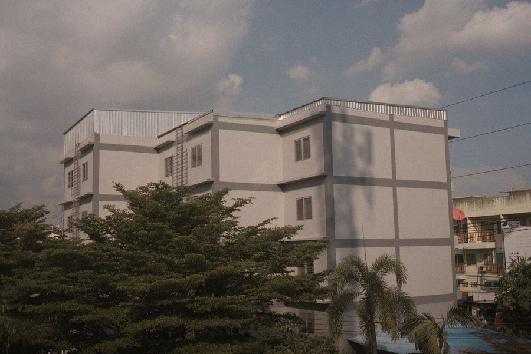</a> <b>Fujifilm Provia 400F</b> ISO 400 · E-6 · Fast slide, clean colour</td><td width="33%"> <b>Fujifilm Provia 400X</b> ISO 400 · E-6 · Fast slide, finer grain</td><td width="33%"> <b>Fujifilm Astia 100F</b> ISO 100 · E-6 · Soft slide film for skin</td></tr>
<tr><td width="33%"> <b>Fujifilm Sensia 100</b> ISO 100 · E-6 · Bright consumer slide</td><td width="33%"> <b>Kodak Kodachrome 25</b> ISO 25 · K-14 · Legendary fine grain, deep reds</td><td width="33%"> <b>Kodak Kodachrome 64</b> ISO 64 · K-14 · Magazine colour of the 70s</td></tr>
<tr><td width="33%"><a href="docs/films/kodachrome200.jpg">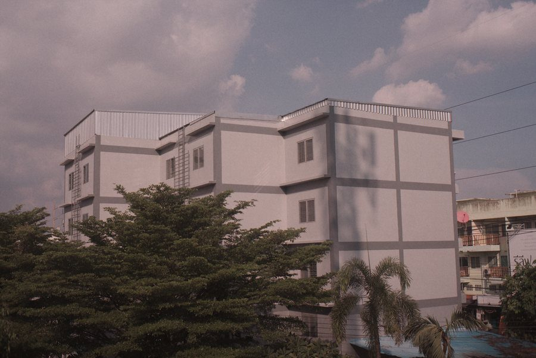</a> <b>Kodak Kodachrome 200</b> ISO 200 · K-14 · Faster Kodachrome, warm grain</td><td width="33%"><a href="docs/films/e100gx.jpg">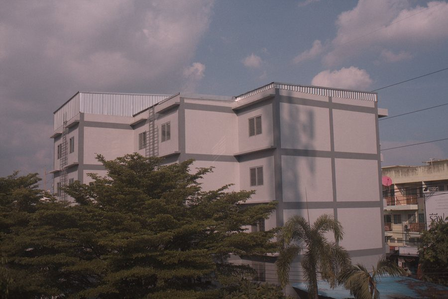</a> <b>Kodak Ektachrome E100GX</b> ISO 100 · E-6 · Warm, gentle Ektachrome</td><td width="33%"><a href="docs/films/e100vs.jpg">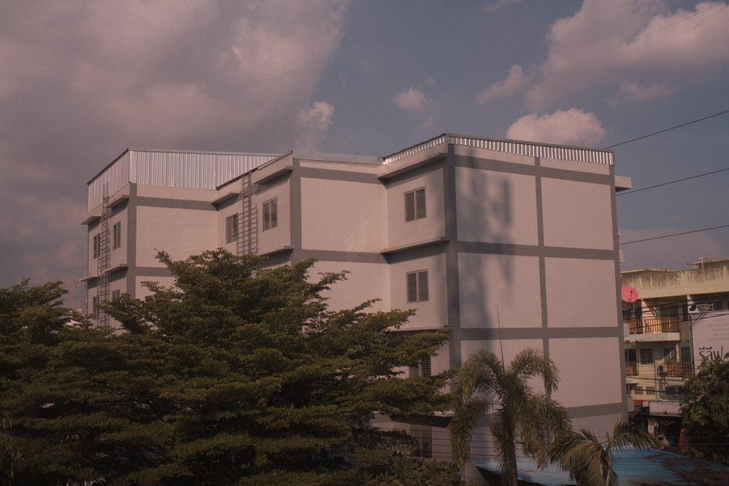</a> <b>Kodak Ektachrome E100VS</b> ISO 100 · E-6 · Very saturated Ektachrome</td></tr>
<tr><td width="33%"> <b>Kodak Elite Chrome 200</b> ISO 200 · E-6 · Everyday Kodak slide</td><td width="33%"> <b>Kodak Elite Chrome 400</b> ISO 400 · E-6 · Fast Kodak slide, more grain</td><td width="33%"> <b>Kodak ExtraColor 100</b> ISO 100 · E-6 · Extra saturated Kodak slide</td></tr>
<tr><td width="33%"> <b>Agfa Precisa 100</b> ISO 100 · E-6 · Cool, crisp Agfa slide</td><td width="33%"><a href="docs/films/elite100xpro.jpg">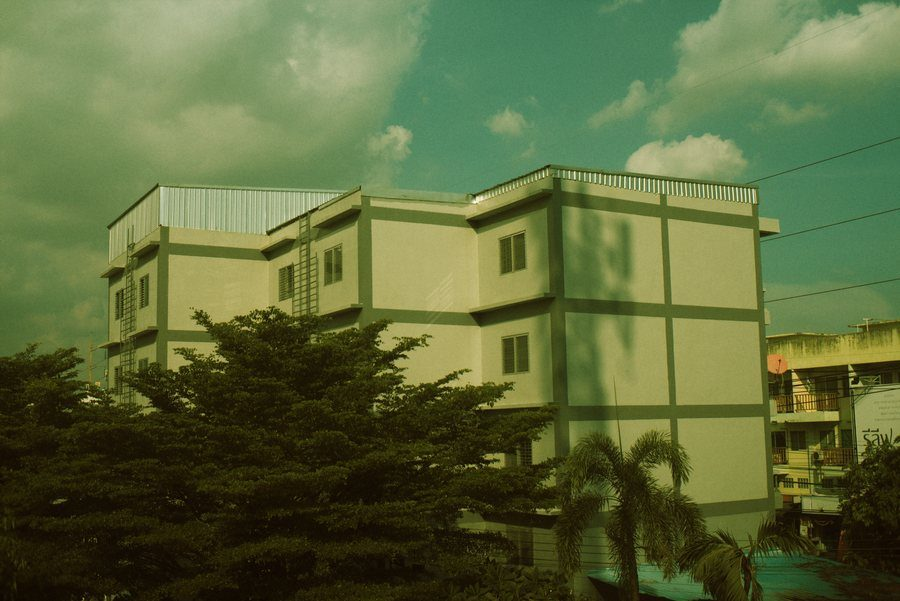</a> <b>Kodak Elite 100 X-Pro</b> ISO 100 · X-PRO · Slide in C-41: wild contrast</td><td width="33%"><a href="docs/films/superia200xpro.jpg">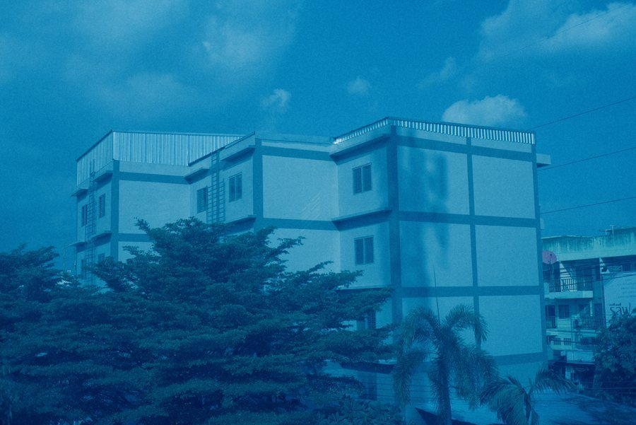</a> <b>Fujifilm Superia 200 X-Pro</b> ISO 200 · X-PRO · Cross-processed, yellow highlights</td></tr>
<tr><td width="33%"> <b>Lomography X-Pro Slide 200</b> ISO 200 · X-PRO · Cross-process blues and yellows</td></tr>
</table>

## Black and white · 22

<table>
<tr><td width="33%"><a href="docs/films/hp5.jpg">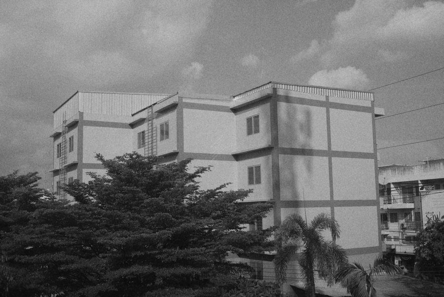</a> <b>Ilford HP5 Plus 400</b> ISO 400 · B&W · Classic B&W, forgiving latitude</td><td width="33%"><a href="docs/films/trix400.jpg">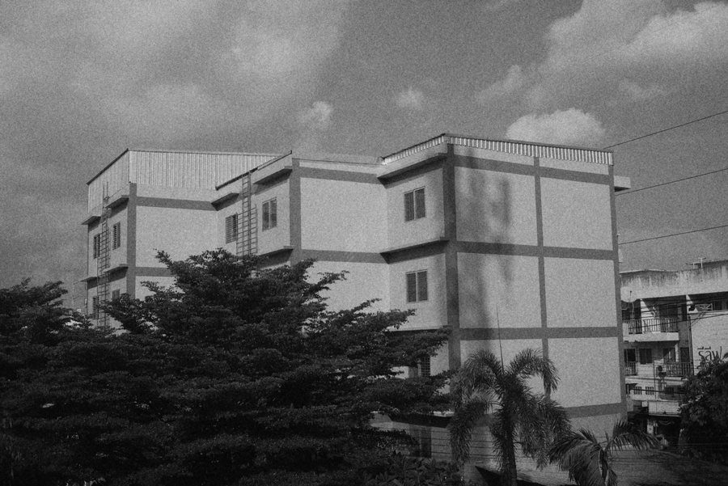</a> <b>Kodak Tri-X 400</b> ISO 400 · B&W · Gritty contrast, street classic</td><td width="33%"> <b>Kodak T-MAX 100</b> ISO 100 · B&W · Ultra fine grain, smooth tones</td></tr>
<tr><td width="33%"> <b>Kodak T-MAX 400</b> ISO 400 · B&W · Sharp, modern B&W</td><td width="33%"><a href="docs/films/tmax3200.jpg">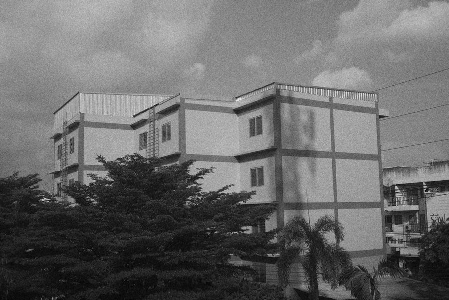</a> <b>Kodak T-MAX P3200</b> ISO 3200 · B&W · Push-ready, grainy nights</td><td width="33%"> <b>Kodak BW400CN</b> ISO 400 · C-41 · Chromogenic B&W, smooth grain</td></tr>
<tr><td width="33%"><a href="docs/films/hie.jpg">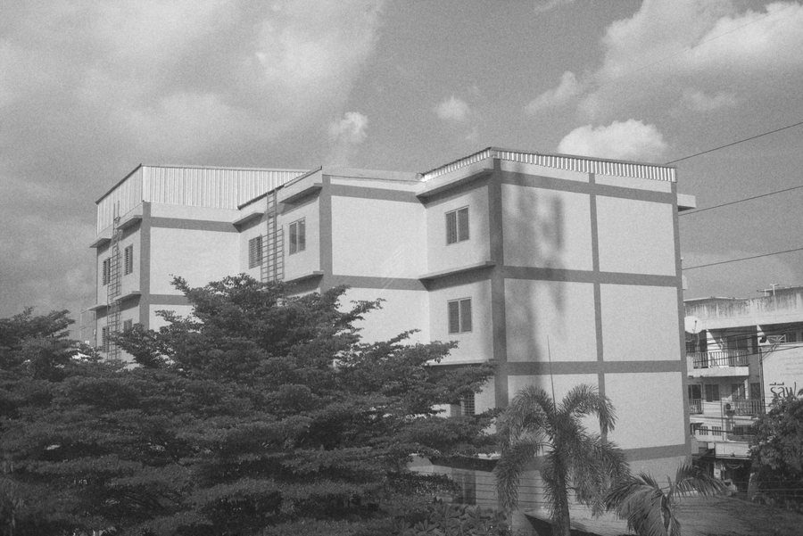</a> <b>Kodak HIE Infrared</b> ISO 400 · B&W · Infrared: white leaves, dark skies</td><td width="33%"> <b>Ilford Delta 100</b> ISO 100 · B&W · Fine, sharp modern B&W</td><td width="33%"> <b>Ilford Delta 400</b> ISO 400 · B&W · Smooth grain at 400</td></tr>
<tr><td width="33%"><a href="docs/films/delta3200.jpg">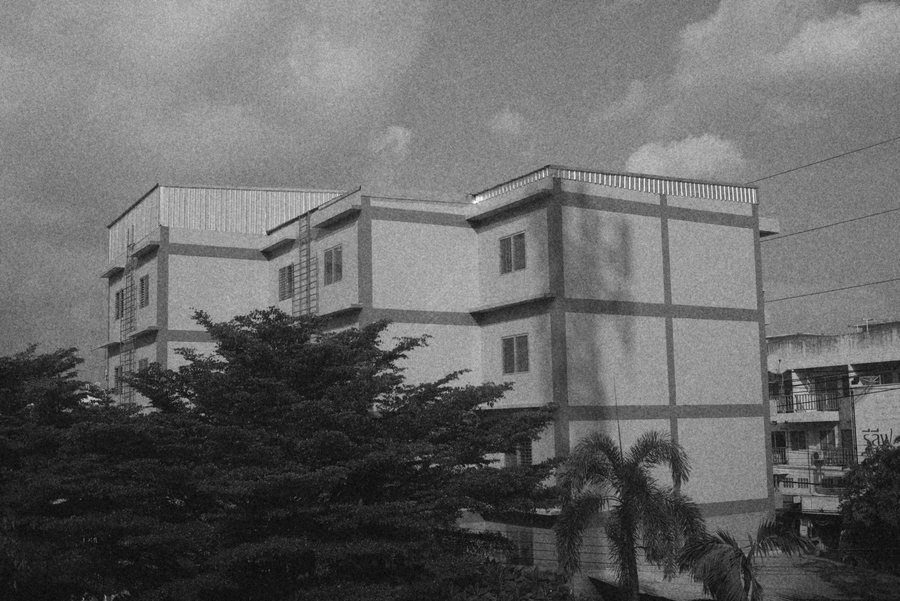</a> <b>Ilford Delta 3200</b> ISO 3200 · B&W · Pushes into the dark</td><td width="33%"> <b>Ilford FP4 Plus</b> ISO 125 · B&W · Classic medium speed B&W</td><td width="33%"> <b>Ilford Pan F Plus</b> ISO 50 · B&W · Slow, super fine grain</td></tr>
<tr><td width="33%"> <b>Ilford HPS 800</b> ISO 800 · B&W · Fast classic Ilford</td><td width="33%"><a href="docs/films/xp2.jpg">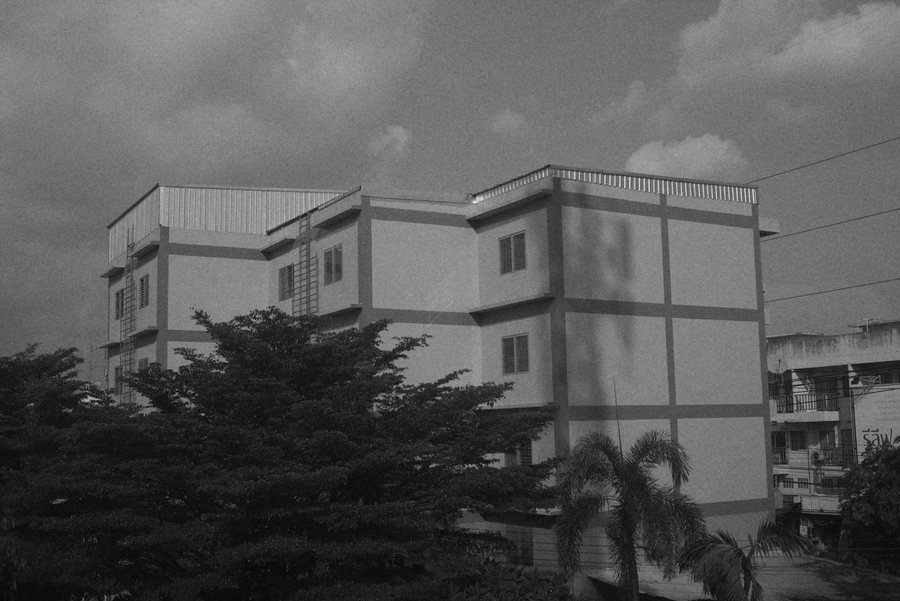</a> <b>Ilford XP2 Super</b> ISO 400 · C-41 · C-41 B&W, smooth tones</td><td width="33%"><a href="docs/films/acros100.jpg">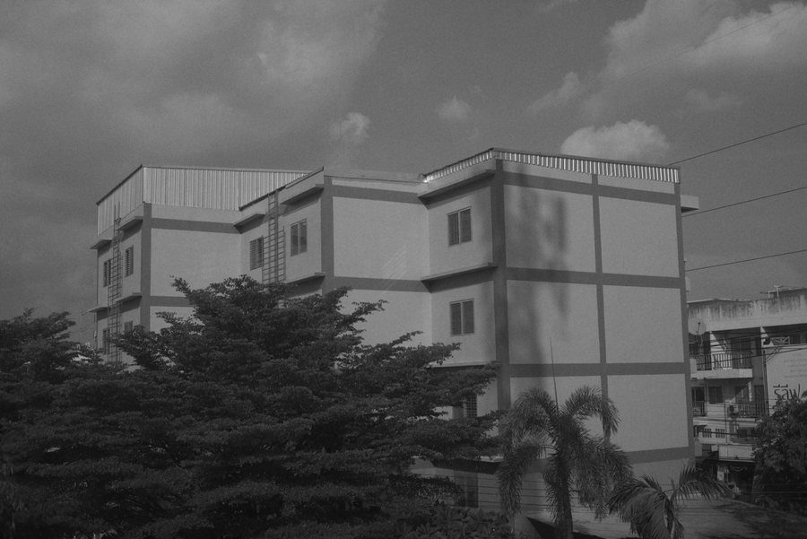</a> <b>Fujifilm Acros 100</b> ISO 100 · B&W · Fine grain, deep blacks</td></tr>
<tr><td width="33%"><a href="docs/films/neopan1600.jpg">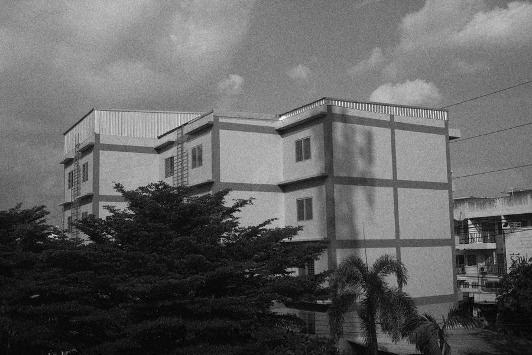</a> <b>Fujifilm Neopan 1600</b> ISO 1600 · B&W · Fast and contrasty B&W</td><td width="33%"> <b>Agfa APX 25</b> ISO 25 · B&W · Very fine, slow Agfa B&W</td><td width="33%"><a href="docs/films/apx100.jpg">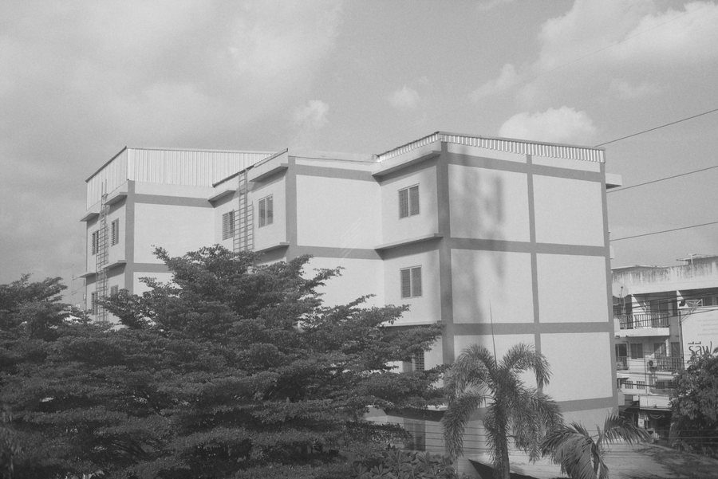</a> <b>Agfa APX 100</b> ISO 100 · B&W · Classic Agfa B&W</td></tr>
<tr><td width="33%"><a href="docs/films/retro80s.jpg">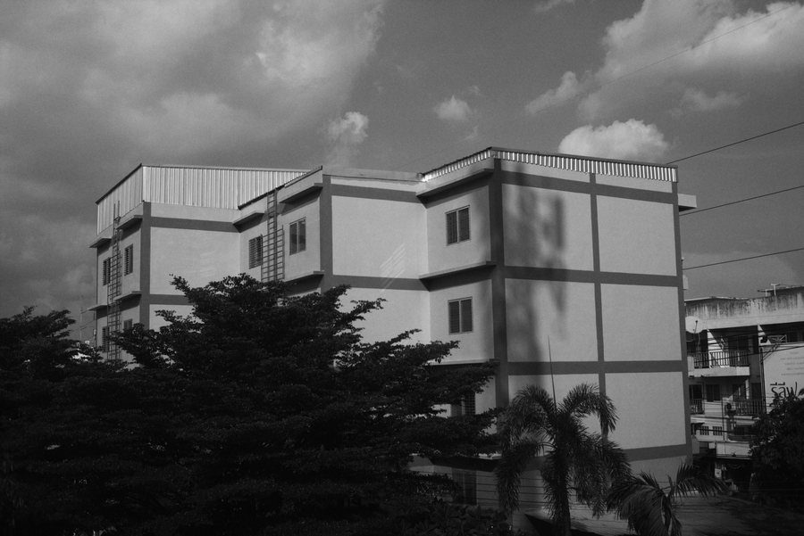</a> <b>Rollei Retro 80S</b> ISO 80 · B&W · Extended red, dark skies</td><td width="33%"> <b>Rollei Retro 100 Tonal</b> ISO 100 · B&W · Soft tonal B&W</td><td width="33%"><a href="docs/films/ortho25.jpg">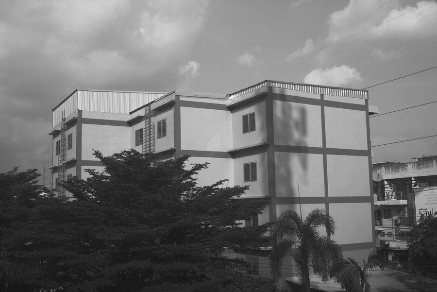</a> <b>Rollei Ortho 25</b> ISO 25 · B&W · Orthochromatic: reds go dark</td></tr>
<tr><td width="33%"><a href="docs/films/ir400.jpg">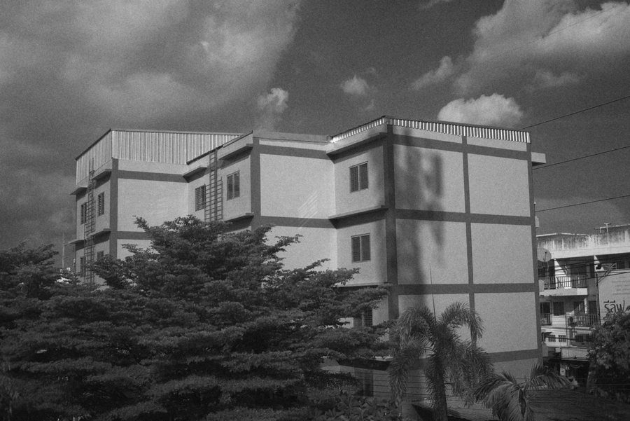</a> <b>Rollei Infrared 400</b> ISO 400 · B&W · Infrared touch, glowing foliage</td></tr>
</table>

## Cinema · 6

<table>
<tr><td width="33%"> <b>CineStill 800T</b> ISO 800 · C-41 · Tungsten cine film, night goes blue</td><td width="33%"><a href="docs/films/cinestill400t.jpg">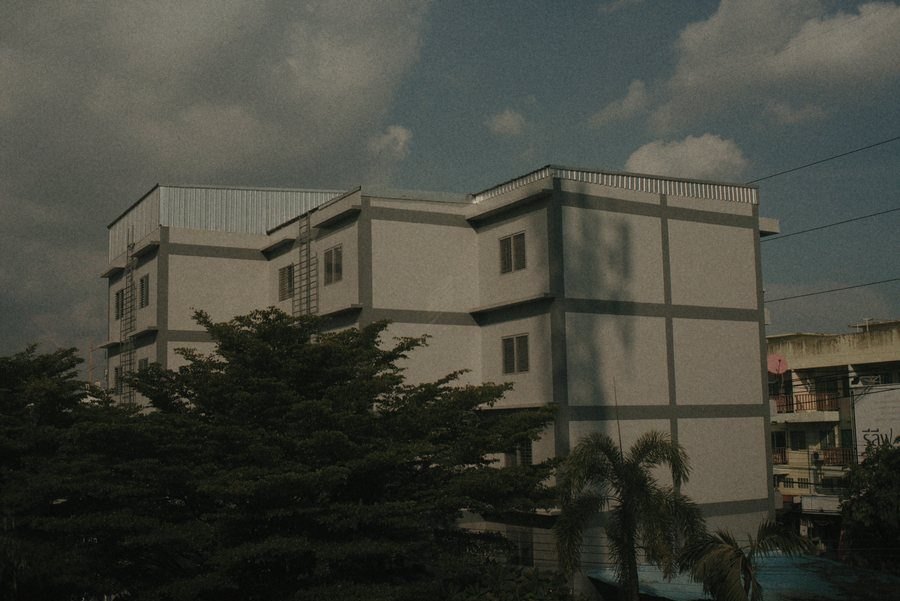</a> <b>CineStill 400T</b> ISO 400 · C-41 · Your own LUT, cine colour</td><td width="33%"><a href="docs/films/kodak2383.jpg">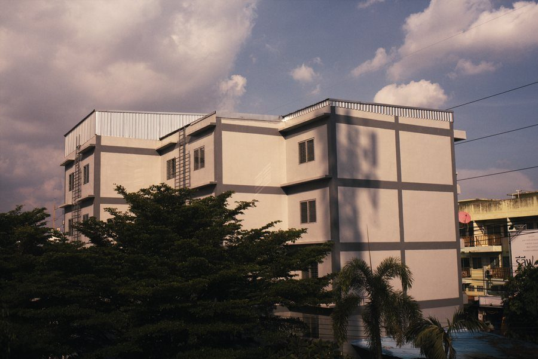</a> <b>Kodak Vision 2383</b> ISO 200 · ECP · Cinema print: teal shadows</td></tr>
<tr><td width="33%"><a href="docs/films/kodak2393.jpg">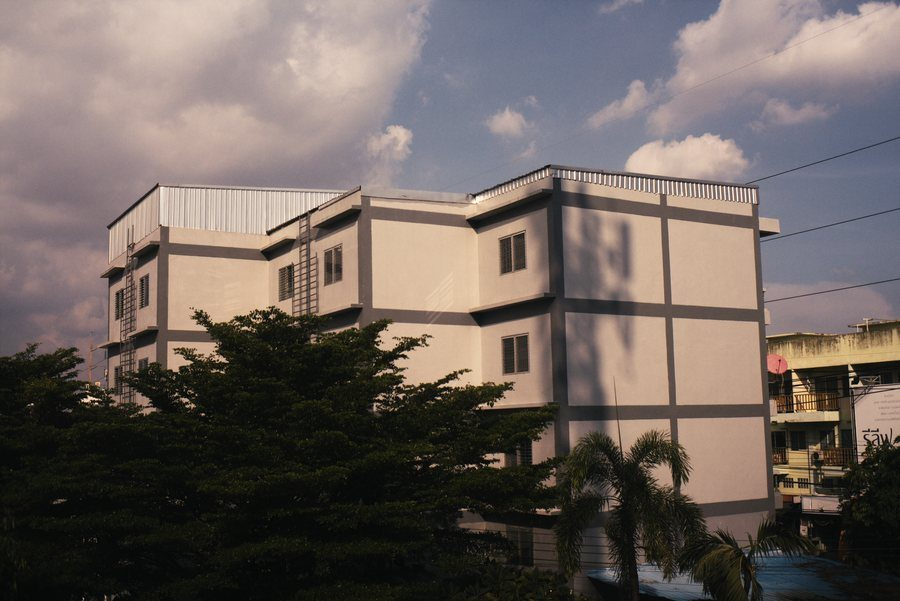</a> <b>Kodak Vision 2393</b> ISO 200 · ECP · Cinema print, richer blacks</td><td width="33%"> <b>Fujifilm Eterna 3510</b> ISO 200 · ECP · Fuji print film, soft colour</td><td width="33%"> <b>Fujifilm Eterna 3513</b> ISO 200 · ECP · Fuji print for digital masters</td></tr>
</table>
