

# M-Film

**Your Canon, shot like film.**

A film camera's interface for Canon cameras that run Magic Lantern. 
Load a roll from a shelf of 72 film stocks, shoot without looking at the screen, then develop the roll: in the camera, or on your computer with **Darkrooms**. 
The camera side is free and open, for everyone.

**English** · [ภาษาไทย](README.th.md) · [Films](#72-films) · [Cameras](#cameras) · [Darkrooms](#develop-on-your-computer-darkrooms) · [Take it further](PORTING.md)

 

---

## A film camera, inside your camera

M-Film replaces the camera's menus with a film camera drawn from scratch, with Magic Lantern running
underneath. There is no picture on the screen after each shot and no going back through them: you shoot
the roll, then develop it and see what you got.

<table>
<tr>
<td width="50%">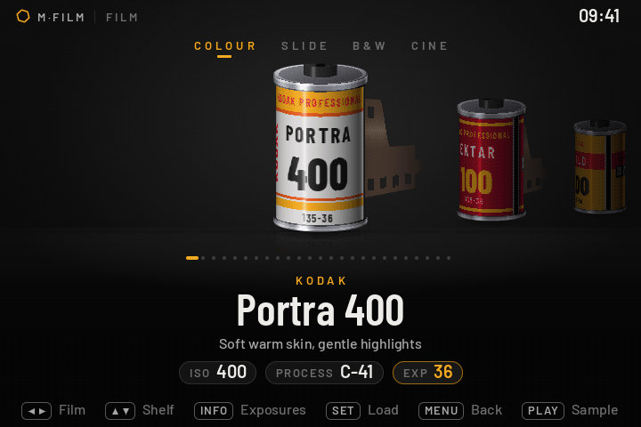</td>
<td width="50%">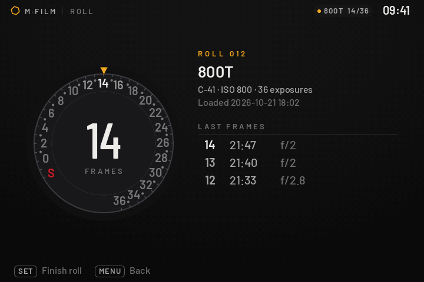</td>
</tr>
<tr>
<td><b>Load a roll.</b> A shelf of canisters that turn to face you. Pick one and the leader comes out of it.</td>
<td><b>Count your frames.</b> A film camera's frame counter, from S to the last frame of the roll.</td>
</tr>
<tr>
<td>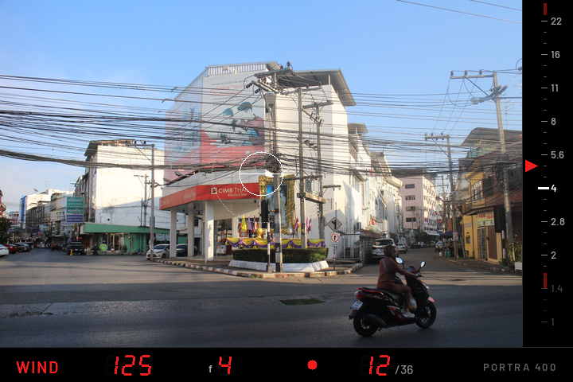</td>
<td>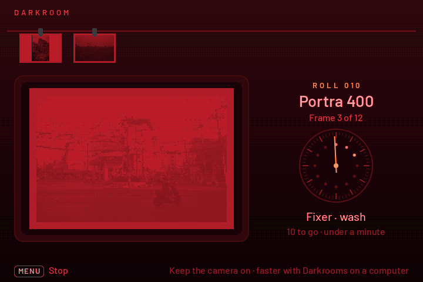</td>
</tr>
<tr>
<td><b>Shoot.</b> An SLR viewfinder over LiveView: aperture scale, light meter needle, red seven-segment frame count.</td>
<td><b>Develop in the camera.</b> The darkroom develops the finished roll frame by frame, into JPEG folders on the card.</td>
</tr>
<tr>
<td>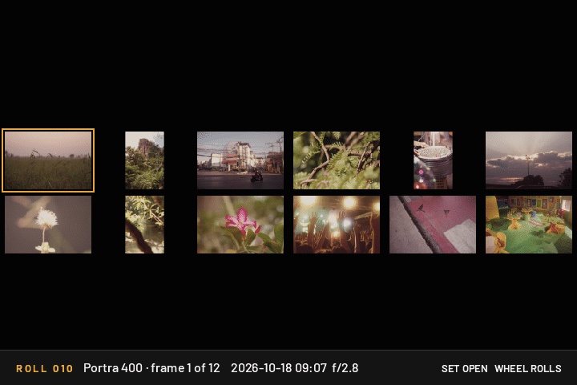</td>
<td>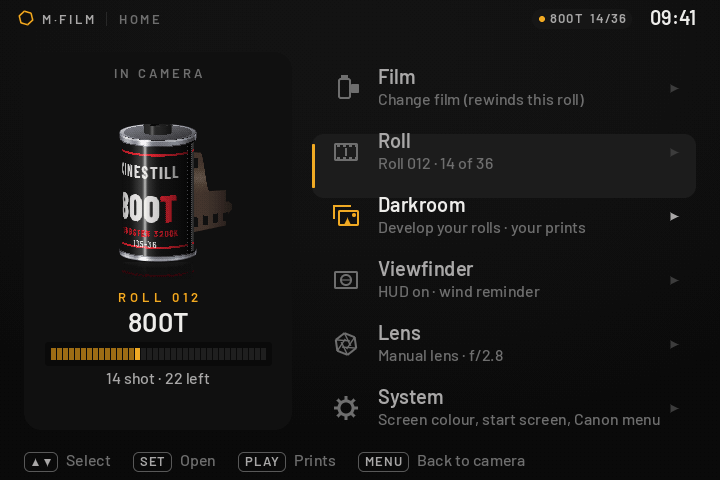</td>
</tr>
<tr>
<td><b>See the prints.</b> A contact sheet of the roll, and each print full screen.</td>
<td><b>Home</b> instead of the camera's menu: the roll you have loaded and everything else.</td>
</tr>
</table>

Every RAW is kept, so nothing is lost: you can develop the same roll again with another film later.

### How big the prints are

The camera's darkroom makes small prints, sized for the camera's screen, so it can develop a frame in the
camera's little memory. For full-size photos, develop the same roll on your computer with
**[Darkrooms](#develop-on-your-computer-darkrooms)**. Your RAWs stay on the card, so you can
develop the rolls you've already shot again, at full size.

| | Horizontal frame | Vertical frame |
|---|---|---|
| **In the camera** | 720 × 480 (0.35 MP) | 320 × 480 (0.15 MP) |
| **Darkrooms on a computer** | the full RAW, e.g. 5472 × 3648 (20 MP) on a 6D | the same, turned upright |

Full size in Darkrooms by camera, about: EOS M, 650D, 700D, 100D 5184 × 3456 · 6D 5472 × 3648 · 5D Mark III 5760 × 3840 · 5D Mark II 5616 × 3744.

### Basic or Realistic

<table>
<tr>
<td width="50%">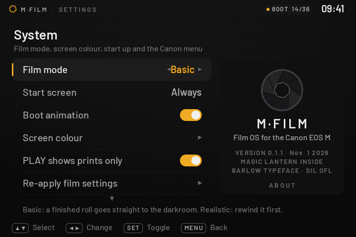</td>
<td width="50%">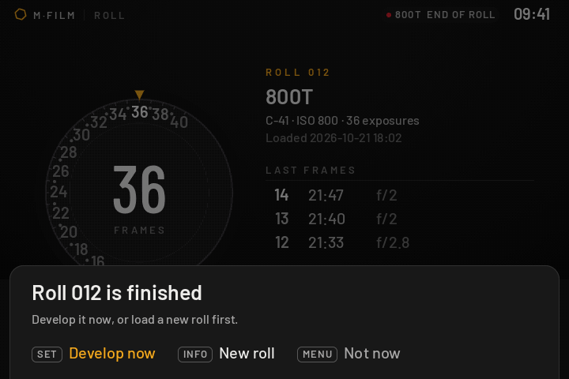</td>
</tr>
<tr>
<td><b>Choose how real.</b> <i>Settings → System → Film mode</i>.</td>
<td><b>Basic</b> (the default): the last frame finishes the roll, and it goes straight to the darkroom. No rewinding.</td>
</tr>
</table>

- **Basic:** shoot, then develop. Stop early with *Finish roll* on the Roll page.
- **Realistic:** like a real film camera. Rewind the roll before it can be developed.
- Either way the roll is the same on the card, so Darkrooms reads both.

### On a DSLR: a top plate

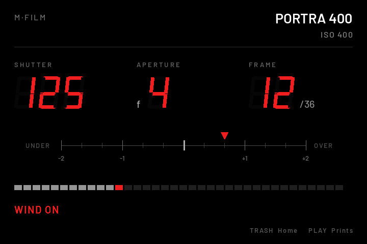

A DSLR shoots through its optical viewfinder, so there is no LiveView to draw on. With a roll loaded and
LiveView off, the back screen becomes a film camera's top plate:

- shutter, aperture and frame in big seven-segment digits
- the film and its ISO
- a light meter from −2 to +2 stops, and a bar of the frames left
- WIND ON when the next frame needs winding

It goes off when you put your eye to the viewfinder, and LiveView brings the viewfinder HUD back.
*New in 0.1.1, still waiting for a DSLR tester: see [Cameras](#cameras).*

---

## 72 films

Colour negative, slide, black and white, and cinema film, on four shelves. Each film has its own colour,
grain, halation and softness; rolls come in 36, 24 or 12 frames.

<!-- samples: one photo per film in docs/samples/<film>.jpg (3:2) -->
<table>
<tr>
<td width="33%"> <b>Kodak Portra 400</b> Soft warm skin, gentle highlights</td>
<td width="33%"> <b>Kodak Gold 200</b> Golden hour, all day long</td>
<td width="33%"> <b>Kodak Ektar 100</b> Punchy colour, ultra fine grain</td>
</tr>
<tr>
<td>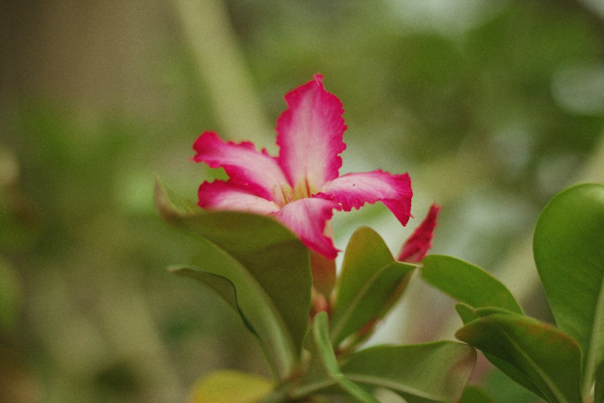 <b>Fujicolor Superia 400</b> Green shadows, everyday snaps</td>
<td>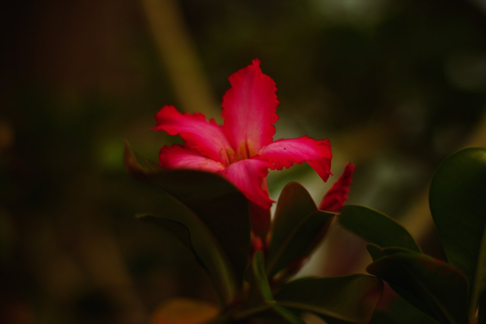 <b>Fujichrome Velvia 50</b> Vivid slide film, hard contrast</td>
<td>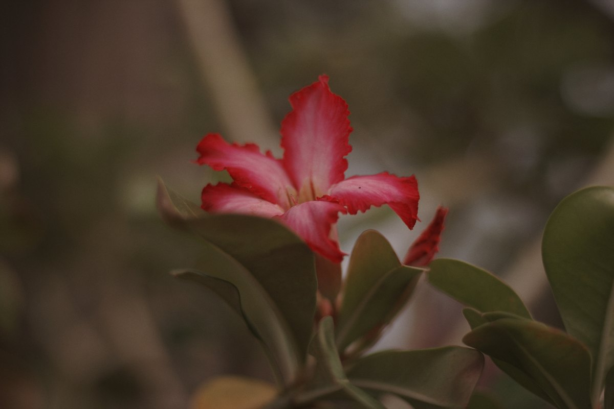 <b>Kodak Kodachrome 64</b> Magazine colour of the 70s</td>
</tr>
<tr>
<td>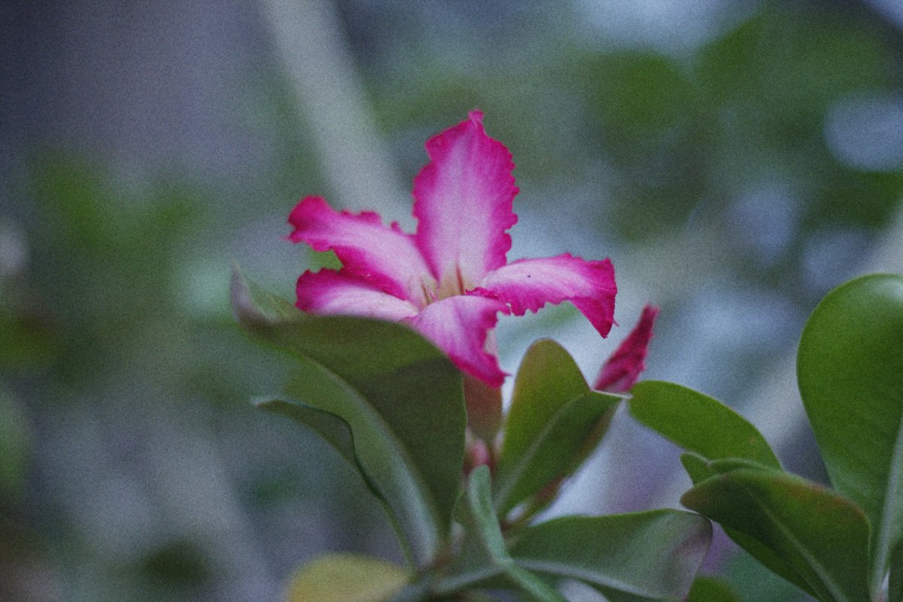 <b>CineStill 800T</b> Tungsten cine film, night goes blue</td>
<td>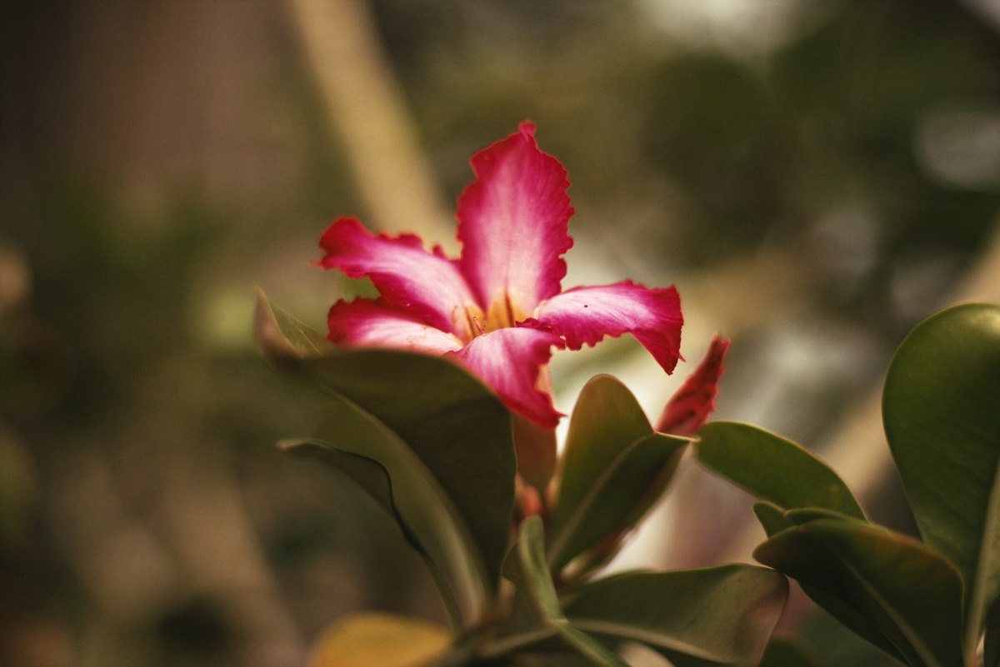 <b>Kodak Vision 2383</b> Cinema print: teal shadows</td>
<td> <b>Kodak Tri-X 400</b> Gritty contrast, street classic</td>
</tr>
</table>

**[All 72 films, on the same photo →](FILMS.md)**

Colour for 63 of them comes from the [Film-Luts](https://github.com/YahiaAngelo/Film-Luts) collection; the rest
from M-Film's own film models ([`ml-dev/films/films.py`](ml-dev/films/films.py)).

---

## Cameras

M-Film was made on the EOS M, where it works. It now builds for every camera on which Magic Lantern
itself is mature (DIGIC 4 and 5). Testers have tried most of them now: the table says how far each one got, and what's
still wrong. If you have one marked *needs a tester*, you can help: [TESTING.md](TESTING.md) says how (about 20 minutes, and you can always go back).

<!-- cameras:start -->
| Camera | Canon firmware | Status | Notes | Card files |
|---|---|---|---|---|
| Canon EOS M | 2.0.2 | ✅ **Works** |  | `M-Film-camera-EOSM.202.zip` (to test: `-module.zip`) |
| Canon EOS 100D / Rebel SL1 / Kiss X7 | 1.0.1 | ✅ **Works** | Works since 0.1.5, the film OS as a module ([#48](../../issues/48)). | `M-Film-camera-100D.101.zip` |
| Canon EOS 650D / Rebel T4i / Kiss X6i | 1.0.4 | ⚠️ Without the in-camera darkroom (develop with Darkrooms) | The full build gives a black screen ([#34](../../issues/34)); a tester's 650D starts without the darkroom. Released that way since 0.1.3: develop on a computer. | `M-Film-camera-650D.104.zip` (to test: `-module.zip`) |
| Canon EOS 700D / Rebel T5i / Kiss X7i | 1.1.5 | ⚠️ Without the in-camera darkroom (develop with Darkrooms) | The full build gives a black screen ([#19](../../issues/19)). Released without the darkroom since 0.1.3, as for the 650D: waiting for a tester. | `M-Film-camera-700D.115.zip` (to test: `-module.zip`) |
| Canon EOS 6D | 1.1.6 | ✅ **Works** | Works since 0.1.2 ([#17](../../issues/17), [#22](../../issues/22)). | `M-Film-camera-6D.116.zip` (to test: `-module.zip`) |
| Canon EOS 70D | 1.1.2 | 🧪 Builds, needs a tester | The film OS as a module fits its boot memory (511,744 of 605,952 bytes). Needs a first tester. | `M-Film-camera-70D.112.zip` |
| Canon EOS 5D Mark III (firmware 1.1.3) | 1.1.3 | ⚠️ Tried, known problem | Starts and shoots; the in-camera darkroom couldn't find the RAWs ([#31](../../issues/31)): fixed in 0.1.3. | `M-Film-camera-5D3.113.zip` (to test: `-module.zip`) |
| Canon EOS 5D Mark III (firmware 1.2.3) | 1.2.3 | ⚠️ Tried, known problem | Starts and shoots; the in-camera darkroom couldn't find the RAWs ([#16](../../issues/16), [#37](../../issues/37)): fixed in 0.1.3. | `M-Film-camera-5D3.123.zip` (to test: `-module.zip`) |
| Canon EOS 550D / Rebel T2i / Kiss X4 | 1.0.9 | ✅ **Works** | Works since 0.1.5, the film OS as a module, darkroom included ([#48](../../issues/48), [#50](../../issues/50)). | `M-Film-camera-550D.109.zip` |
| Canon EOS 600D / Rebel T3i / Kiss X5 | 1.0.2 | ✅ **Works** | Works since 0.1.5, the film OS as a module ([#46](../../issues/46)). | `M-Film-camera-600D.102.zip` |
| Canon EOS 60D | 1.1.1 | ✅ **Works** | Works since 0.1.3 ([#25](../../issues/25)). 0.1.5: Screen orientation for a broken hinge switch ([#49](../../issues/49)). | `M-Film-camera-60D.111.zip` (to test: `-module.zip`) |
| Canon EOS 1100D / Rebel T3 / Kiss X50 | 1.0.5 | 🧪 Builds, needs a tester | The film OS as a module fits its boot memory (493,056 of 524,032 bytes). Needs a first tester. | `M-Film-camera-1100D.105.zip` |
| Canon EOS 500D / Rebel T1i / Kiss X3 | 1.1.1 | ✅ **Works** | Works ([#44](../../issues/44)). 0.1.5 repaints when Canon draws over the plate. | `M-Film-camera-500D.111.zip` (to test: `-module.zip`) |
| Canon EOS 50D | 1.0.9 | ✅ **Works** | Works ([#43](../../issues/43)). 0.1.5 repaints when Canon draws over the plate. | `M-Film-camera-50D.109.zip` (to test: `-module.zip`) |
| Canon EOS 5D Mark II | 2.1.2 | ⚠️ Tried, known problem | Most hang at power on: the build is too big at start-up ([#18](../../issues/18)). 0.1.3 has a smaller one (some Magic Lantern features left out, the darkroom kept) and fixes the pink prints: waiting for testers. | `M-Film-camera-5D2.212.zip` (to test: `-module.zip`) |

**Not yet:** 7D (Magic Lantern's current source doesn't build it) · 200D, 750D, 77D, 80D, 7D Mark II, 5D Mark IV, 5DS R, 6D Mark II, 850D, M50, R, RP, R5, R6, SX70 HS, SX740 HS (Magic Lantern itself is still experimental on these).
<!-- cameras:end -->

✅ tried on the camera and works · 🧪 builds; waiting for someone to try it · 🔧 bigger than the memory Magic Lantern gets at boot there ([why](ml-dev/MEMORY.md)). The card files are in each
[release](../../releases/latest). The list lives in [`ml-dev/cameras.txt`](ml-dev/cameras.txt); porting
notes in [PORTING.md](PORTING.md).

### Putting it on the camera

1. The camera needs exactly the Canon firmware in the table (MENU → last settings tab → *Firmware ver.*).
2. Unzip the card files for your camera onto an SD card, put it in the camera and run *Firmware ver.* →
   update once. From then on M-Film starts with the camera from that card.
3. Full steps, and how to go back: [TESTING.md](TESTING.md). Building it yourself:
   `ml-dev/build_fork.sh <camera>`.

### Updating to a new version

Don't unzip a new version over the old one: files left from before can make the camera misbehave.
Start from a clean card instead:

1. **Finish the roll** and develop it, in the camera or with Darkrooms. A new install starts with no roll loaded.
2. **Copy your photos off the card** (the `DCIM` folder), including the developed JPEG folders.
3. **Format the card in the camera** and choose to remove Magic Lantern.
4. **Unzip the new version** onto the card, as on the first install.
5. Put the card in the camera and run *Firmware ver.* → update again, then switch the camera on.

Your settings (film, screen colour, Film mode) go back to their defaults: set them again.

---

## Develop on your computer: Darkrooms

The camera develops its rolls by itself, slowly. **Darkrooms** does it on your computer, fast.
Plug the camera in (or put its card in a reader) and open Darkrooms. It finds the camera, shows every
roll you shot with its film, and develops them at full resolution.

<table>
<tr>
<td width="50%">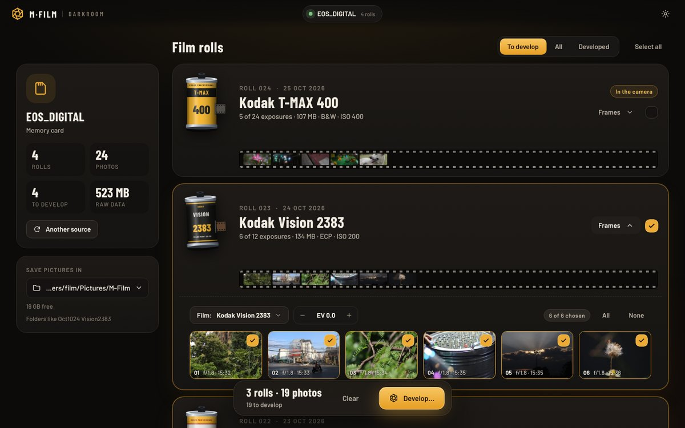</td>
<td width="50%">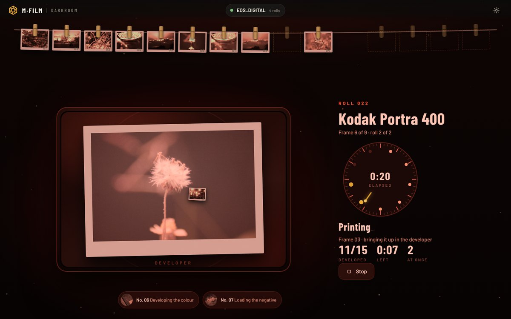</td>
</tr>
<tr>
<td><b>Your rolls</b>, each with its canister and a strip of its frames. Develop whole rolls or pick single frames.</td>
<td><b>The lights go red.</b> Prints come out of the developer and hang on the line.</td>
</tr>
<tr>
<td>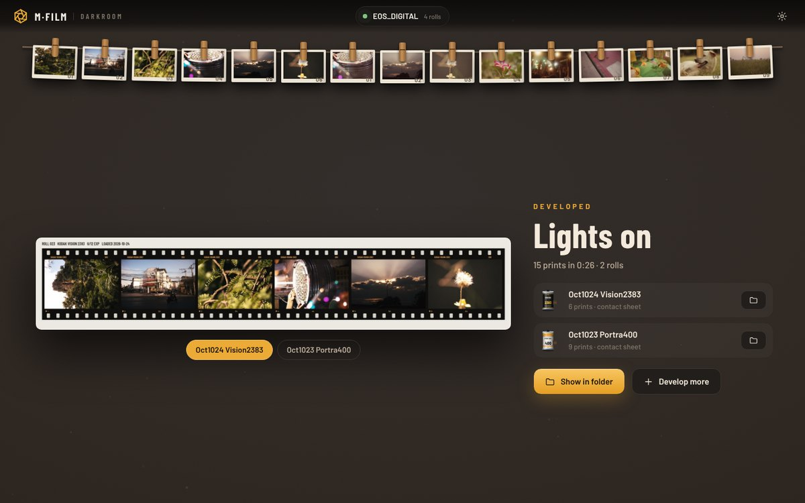</td>
<td>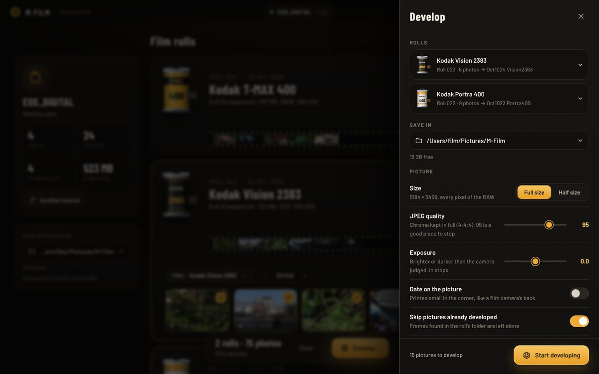</td>
</tr>
<tr>
<td><b>Lights on.</b> Every roll gets a contact sheet and its own folder.</td>
<td><b>Full detail.</b> Every pixel of the RAW, JPEG with 4:4:4 colour, EXIF kept, optional date stamp.</td>
</tr>
</table>

### Free, or Full

| | Free | Darkrooms Full |
|---|---|---|
| Rolls a day | 1, of up to 36 frames (the same roll again that day doesn't count) | as many as you like |
| Every film, full size, EXIF, contact sheets | ✓ | ✓ |
| Many rolls at once on every core | | ✓ |
| Price | free, with a Google account | **US$2.99 a month** or **US$14.99 once** (checkout shows your currency), updates included |

The camera's own darkroom stays free and unlimited. Darkrooms goes with your **Google account**: no key to type in or keep.
Click the badge at the top right → *Sign in with Google*, then *Get it monthly* or *Get it for life*. After you pay,
Darkrooms switches to Full by itself within a few seconds. One account works on **two computers** at a time
(sign in on the other one with the same Google account). Cancel the monthly plan any time in the program
(*Manage the subscription*): it stays on until the end of the month paid for.

### Download

| Your computer | Get | Open it |
|---|---|---|
| **Windows 10 / 11** | `Darkrooms-windows-x64.zip` | Unzip, run `Darkrooms.exe`. If Windows warns: *More info* → *Run anyway*. |
| **Mac with Intel** | `Darkrooms-macos-intel.zip` | Unzip, drag to Applications and open it. The first time: *System Settings → Privacy & Security → Open Anyway* (macOS 14 and older: right-click → Open). |
| **Mac with Apple silicon** | `Darkrooms-macos-apple-silicon.zip` | Same. |

From the **[Darkrooms releases](../../releases?q=Darkrooms&expanded=true)** (the newest is at the top). About 25–45 MB. The program isn't signed with Apple or
Microsoft yet, hence the warning the first time.

---

## Take it further

- **Have one of the cameras above?** [TESTING.md](TESTING.md): try it and tell us, so it can move to ✅.
- **Another camera?** [PORTING.md](PORTING.md) says what moves easily (the Film OS
  screens), what has to be redone per camera (the Magic Lantern side), and how to go about it.
- **Every screen and button** of the camera side, and how it works inside (in Thai):
  [docs/MANUAL.th.md](docs/MANUAL.th.md).
- **Something broken?** [Open an issue](../../issues/new/choose) and paste what the gear icon →
  *What does the computer see?* shows.
- **The films** (looks, LUT list) are in [`ml-dev/films/`](ml-dev/films/); the camera build bakes them in.
- **Darkrooms**, the desktop program, is closed source and isn't in this repository.

## Support

The camera side of M-Film is free and stays free. If it gave you a roll you like, you can
**[buy the developer a coffee ☕](https://buy.stripe.com/7sY14p8d93QE5Ny5M58so02)**.

## License

This repository: GPL-2.0 ([LICENSE](LICENSE)), as the camera side builds on Magic Lantern.
Darkrooms (the desktop program) is a separate, closed-source program under its own licence. Fonts, film LUTs and other
parts: [THIRD_PARTY.md](THIRD_PARTY.md). Not affiliated with Canon, Kodak, Fujifilm or any film maker.
