

# M-Film

**เปลี่ยนกล้อง Canon ของคุณให้ถ่ายเหมือนกล้องฟิล์ม**

หน้าจอแบบกล้องฟิล์มสำหรับกล้อง Canon ที่ลง Magic Lantern ได้ 
เลือกม้วนจากชั้นวางฟิล์ม 72 แบบ ถ่ายโดยไม่เห็นภาพบนจอ แล้วล้างฟิล์มทั้งม้วน ในกล้องเองหรือบนคอมด้วย **Darkrooms** 
ส่วนในกล้องใช้ฟรีและเปิดซอร์สสำหรับทุกคน

[English](README.md) · **ภาษาไทย** · [ฟิล์ม](#ฟิล์ม-72-แบบ) · [กล้องที่รองรับ](#กล้องที่รองรับ) · [Darkrooms](#ล้างบนคอม-darkrooms) · [คู่มือในกล้อง](docs/MANUAL.th.md) · [ทำต่อยอด](PORTING.md)

 

---

## กล้องฟิล์ม อยู่ในกล้องของคุณ

M-Film เปลี่ยนเมนูของกล้องเป็นหน้าจอกล้องฟิล์มที่วาดขึ้นใหม่ทั้งหมด โดยมี Magic Lantern ทำงานอยู่ข้างใต้
ถ่ายแล้วไม่มีภาพขึ้นบนจอ และย้อนดูรูปไม่ได้ ถ่ายให้ครบม้วนก่อน แล้วล้างฟิล์มถึงจะได้เห็นว่าได้รูปอะไรมาบ้าง

<table>
<tr>
<td width="50%">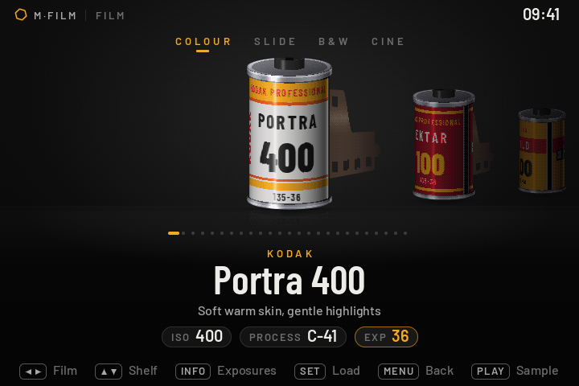</td>
<td width="50%">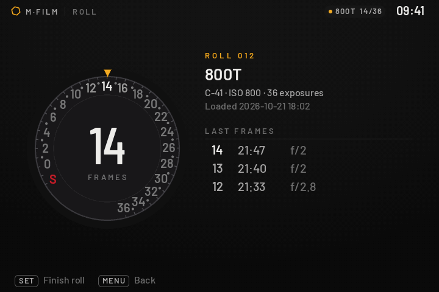</td>
</tr>
<tr>
<td><b>ใส่ฟิล์ม</b> ชั้นวางกลักฟิล์มที่หมุนหันเข้าหาคุณ เลือกม้วนแล้วหางฟิล์มจะถูกดึงออกมาจากกลัก</td>
<td><b>นับรูป</b> หน้าปัดนับรูปแบบกล้องฟิล์ม ตั้งแต่ S จนถึงรูปสุดท้ายของม้วน และกรอฟิล์มกลับได้</td>
</tr>
<tr>
<td>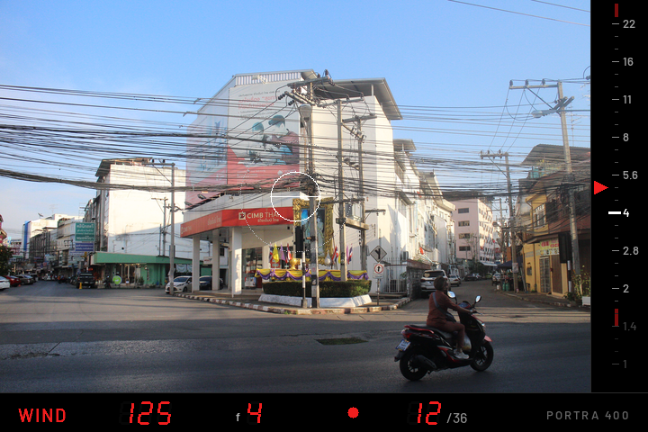</td>
<td>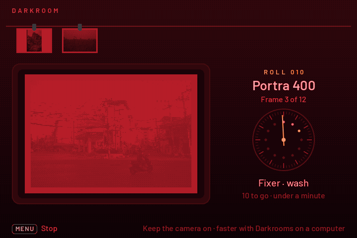</td>
</tr>
<tr>
<td><b>ถ่าย</b> แบบช่องมองของกล้อง SLR: สเกลรูรับแสง เข็มวัดแสง และตัวเลขนับรูปสีแดงแบบ 7 ส่วน</td>
<td><b>ล้างฟิล์มในกล้อง</b> ห้องมืดล้างม้วนที่ถ่ายครบทีละรูป ออกมาเป็นโฟลเดอร์ JPEG บนการ์ด</td>
</tr>
<tr>
<td>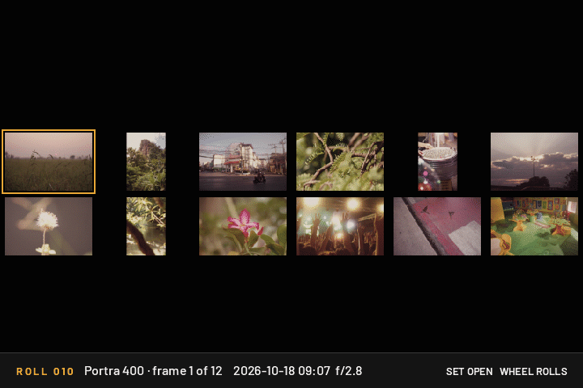</td>
<td>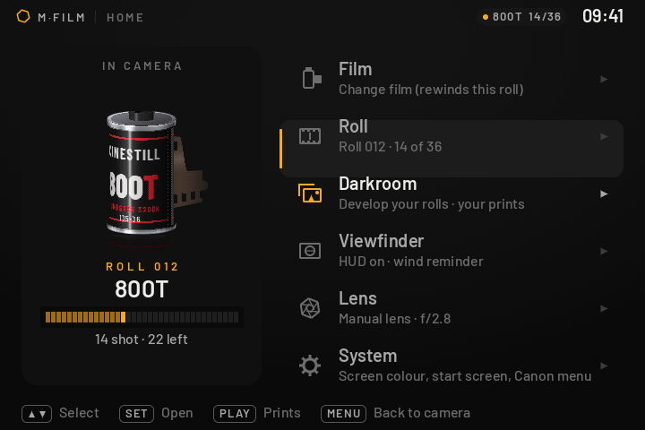</td>
</tr>
<tr>
<td><b>ดูรูปที่ล้างแล้ว</b> contact sheet ของทั้งม้วน และดูทีละรูปเต็มจอ</td>
<td><b>Home</b> แทนเมนูของกล้อง: ม้วนที่ใส่อยู่ และทางไปหน้าอื่นๆ</td>
</tr>
</table>

ไฟล์ RAW ยังเก็บไว้ครบทุกรูป ไม่มีอะไรหาย จะเอาม้วนเดิมไปล้างใหม่ด้วยฟิล์มอื่นทีหลังก็ได้

ทุกหน้าจอและทุกปุ่ม: **[คู่มือในกล้อง](docs/MANUAL.th.md)**

---

## ฟิล์ม 72 แบบ

มีทั้งฟิล์มสีเนกาทีฟ สไลด์ ขาวดำ และฟิล์มภาพยนตร์ แยกไว้บนชั้นวาง 4 ชั้น ฟิล์มแต่ละแบบมีสี เกรน halation
และความนุ่มของภาพเป็นของตัวเอง ม้วนหนึ่งเลือกได้ 36, 24 หรือ 12 รูป

<!-- samples: one photo per film in docs/samples/<film>.jpg (3:2) -->
<table>
<tr>
<td width="33%">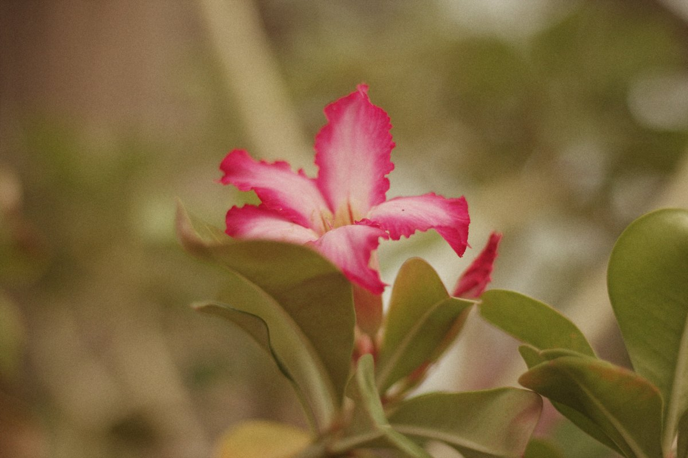 <b>Kodak Portra 400</b> สีผิวอุ่นนุ่ม ไฮไลต์ละมุน</td>
<td width="33%">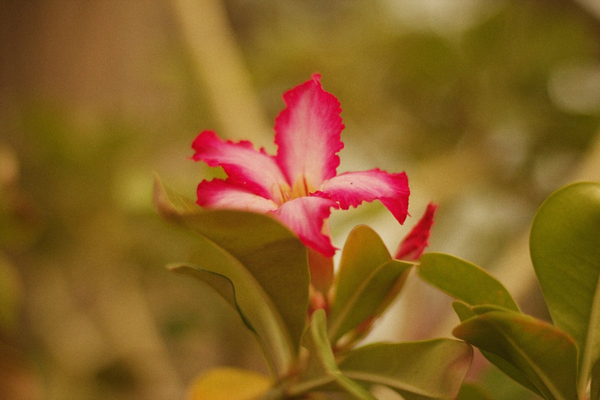 <b>Kodak Gold 200</b> แสงทองยามเย็นได้ทั้งวัน</td>
<td width="33%">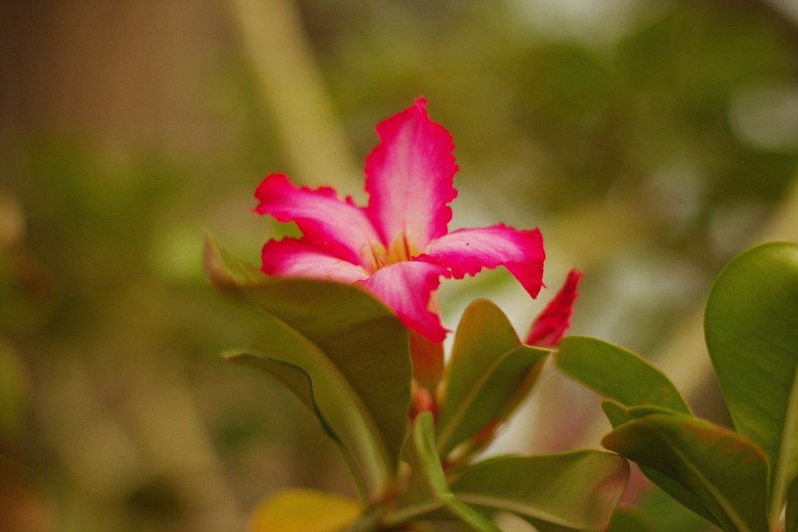 <b>Kodak Ektar 100</b> สีจัด เกรนละเอียดมาก</td>
</tr>
<tr>
<td>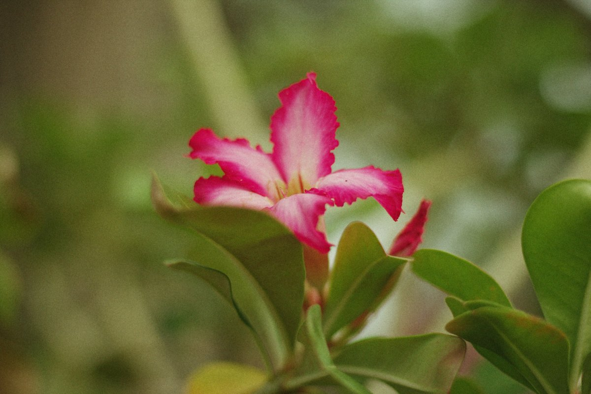 <b>Fujicolor Superia 400</b> เงาออกเขียว ฟิล์มถ่ายเล่นทุกวัน</td>
<td>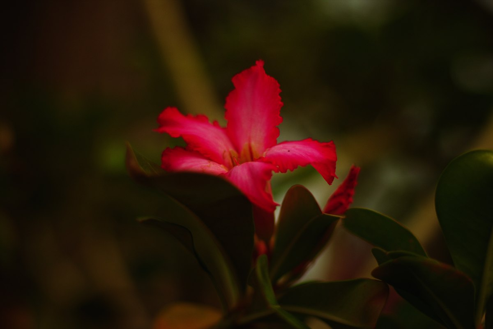 <b>Fujichrome Velvia 50</b> ฟิล์มสไลด์สีสด คอนทราสต์แรง</td>
<td>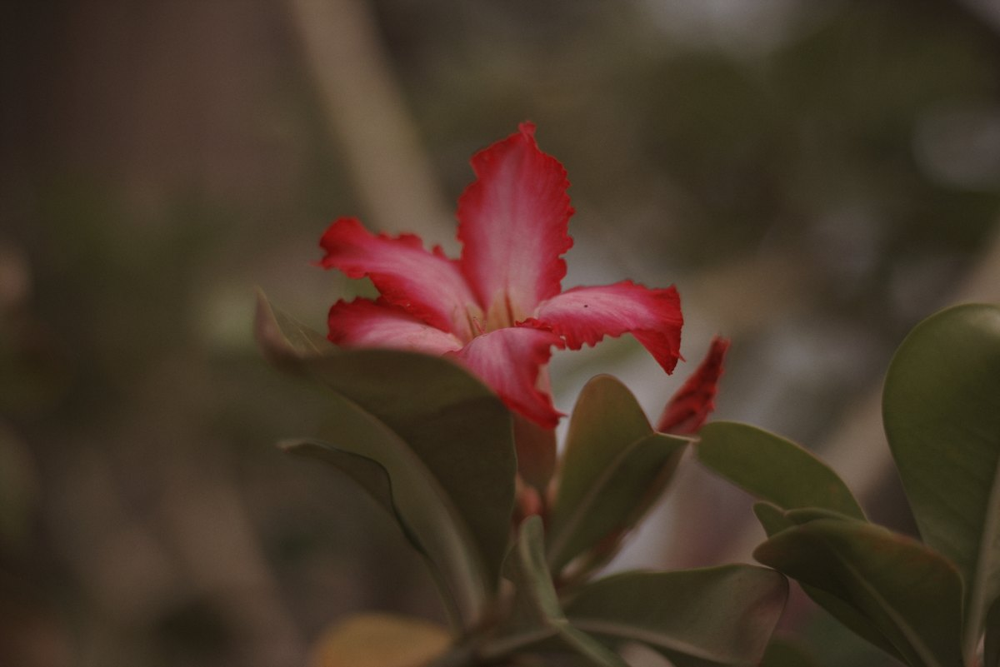 <b>Kodak Kodachrome 64</b> สีแบบนิตยสารยุค 70</td>
</tr>
<tr>
<td> <b>CineStill 800T</b> ฟิล์มหนังแสงไฟ กลางคืนออกฟ้า</td>
<td>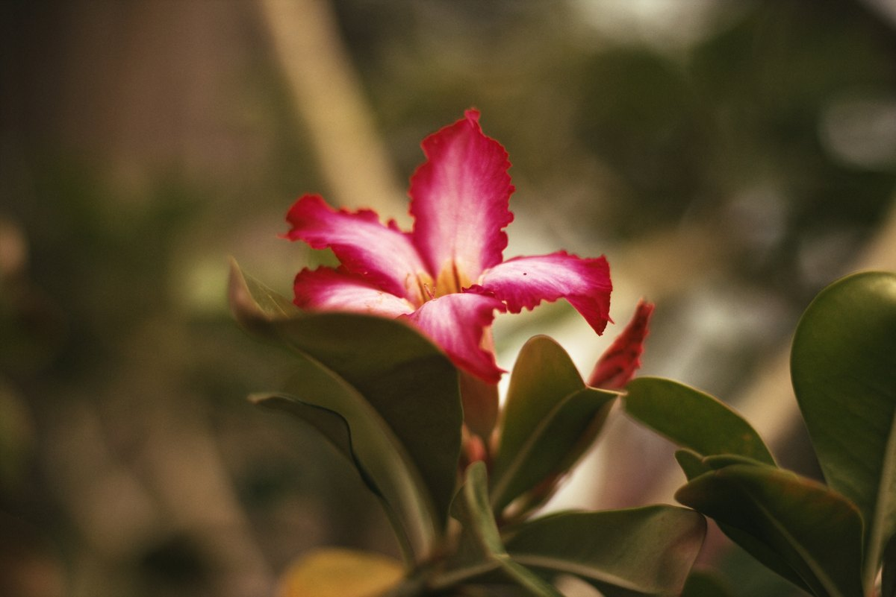 <b>Kodak Vision 2383</b> ฟิล์มพิมพ์ภาพยนตร์ เงาออกเขียวอมฟ้า</td>
<td> <b>Kodak Tri-X 400</b> ขาวดำคอนทราสต์ดิบ คลาสสิกของสตรีท</td>
</tr>
</table>

**[ดูฟิล์มทั้ง 72 แบบ บนรูปเดียวกัน →](FILMS.md)**

สีของฟิล์ม 63 แบบมาจากชุด [Film-Luts](https://github.com/YahiaAngelo/Film-Luts) ที่เหลือมาจากโมเดลฟิล์มของ M-Film เอง
([`ml-dev/films/films.py`](ml-dev/films/films.py))

---

## กล้องที่รองรับ

M-Film ทำบน EOS M และใช้ได้จริงบนรุ่นนั้น ตอนนี้ build ได้แล้วกับทุกรุ่นที่ Magic Lantern เองใช้ได้อย่างเสถียร
(DIGIC 4 และ 5) แต่รุ่นเหล่านั้น **ยังไม่เคยมีใครลองบนกล้องจริง** ถ้าคุณมีกล้องรุ่นไหนในตาราง ช่วยทดสอบได้:
[TESTING.md](TESTING.md) บอกวิธีไว้ (ใช้เวลาประมาณ 20 นาที และถอดกลับได้เสมอ)

<!-- cameras:start -->
| กล้อง | เฟิร์มแวร์ Canon | สถานะ | ไฟล์ลงการ์ด |
|---|---|---|---|
| Canon EOS M | 2.0.2 | ✅ **ใช้ได้** | `M-Film-camera-EOSM.202.zip` |
| Canon EOS 100D / Rebel SL1 / Kiss X7 | 1.0.1 | 🔧 ใหญ่เกินหน่วยความจำตอนบูต: กำลังแก้ |  |
| Canon EOS 650D / Rebel T4i / Kiss X6i | 1.0.4 | 🧪 build ได้แล้ว รอคนทดสอบ | `M-Film-camera-650D.104.zip` |
| Canon EOS 700D / Rebel T5i / Kiss X7i | 1.1.5 | 🧪 build ได้แล้ว รอคนทดสอบ | `M-Film-camera-700D.115.zip` |
| Canon EOS 6D | 1.1.6 | 🧪 build ได้แล้ว รอคนทดสอบ | `M-Film-camera-6D.116.zip` |
| Canon EOS 70D | 1.1.2 | 🔧 ใหญ่เกินหน่วยความจำตอนบูต: กำลังแก้ |  |
| Canon EOS 5D Mark III (firmware 1.1.3) | 1.1.3 | 🧪 build ได้แล้ว รอคนทดสอบ | `M-Film-camera-5D3.113.zip` |
| Canon EOS 5D Mark III (firmware 1.2.3) | 1.2.3 | 🧪 build ได้แล้ว รอคนทดสอบ | `M-Film-camera-5D3.123.zip` |
| Canon EOS 550D / Rebel T2i / Kiss X4 | 1.0.9 | 🔧 ใหญ่เกินหน่วยความจำตอนบูต: กำลังแก้ |  |
| Canon EOS 600D / Rebel T3i / Kiss X5 | 1.0.2 | 🔧 ใหญ่เกินหน่วยความจำตอนบูต: กำลังแก้ |  |
| Canon EOS 60D | 1.1.1 | 🧪 build ได้แล้ว รอคนทดสอบ | `M-Film-camera-60D.111.zip` |
| Canon EOS 1100D / Rebel T3 / Kiss X50 | 1.0.5 | 🔧 ใหญ่เกินหน่วยความจำตอนบูต: กำลังแก้ |  |
| Canon EOS 500D / Rebel T1i / Kiss X3 | 1.1.1 | 🧪 build ได้แล้ว รอคนทดสอบ | `M-Film-camera-500D.111.zip` |
| Canon EOS 50D | 1.0.9 | 🧪 build ได้แล้ว รอคนทดสอบ | `M-Film-camera-50D.109.zip` |
| Canon EOS 5D Mark II | 2.1.2 | 🧪 build ได้แล้ว รอคนทดสอบ | `M-Film-camera-5D2.212.zip` |

**ยังไม่รองรับ:** 7D (source ปัจจุบันของ Magic Lantern build รุ่นนี้ไม่ได้) · 200D, 750D, 77D, 80D, 7D Mark II, 5D Mark IV, 5DS R, 6D Mark II, 850D, M50, R, RP, R5, R6, SX70 HS, SX740 HS (Magic Lantern เองยังเป็นรุ่นทดลองบนกล้องเหล่านี้)
<!-- cameras:end -->

✅ ลองบนกล้องแล้ว ใช้ได้ · 🧪 build ได้แล้ว รอคนลอง · 🔧 ใหญ่เกินหน่วยความจำที่ ML ได้ตอนบูตบนรุ่นนั้น ([เหตุผล](ml-dev/MEMORY.md)) ไฟล์ลงการ์ดอยู่ใน [release](../../releases/latest) แต่ละเวอร์ชัน
รายชื่อกล้องอยู่ที่ [`ml-dev/cameras.txt`](ml-dev/cameras.txt) วิธีทำให้กล้องรุ่นอื่นอยู่ใน [PORTING.md](PORTING.md)

### ลงในกล้อง

1. เฟิร์มแวร์ Canon ต้องตรงกับในตารางเป๊ะๆ (MENU → แท็บตั้งค่าแท็บสุดท้าย → *Firmware ver.*)
2. แตกไฟล์ลงการ์ดของรุ่นคุณลงการ์ด SD ใส่การ์ดในกล้อง แล้วกด *Firmware ver.* → update ครั้งเดียว
   หลังจากนั้นเปิดกล้องด้วยการ์ดใบนั้น M-Film จะเปิดขึ้นมาพร้อมกล้องเลย
3. ขั้นตอนเต็มและวิธีถอดออก: [TESTING.md](TESTING.md) จะ build เอง: `ml-dev/build_fork.sh <กล้อง>`

---

## ล้างบนคอม: Darkrooms

กล้องล้างม้วนได้เองแต่ช้า **Darkrooms** ล้างบนคอมได้เร็วกว่ามาก เสียบกล้อง (หรือใส่การ์ดในเครื่องอ่านการ์ด)
แล้วเปิด Darkrooms โปรแกรมจะเจอกล้องเอง แสดงทุกม้วนที่ถ่ายพร้อมฟิล์มของม้วนนั้น แล้วล้างแบบความละเอียดเต็ม

<table>
<tr>
<td width="50%">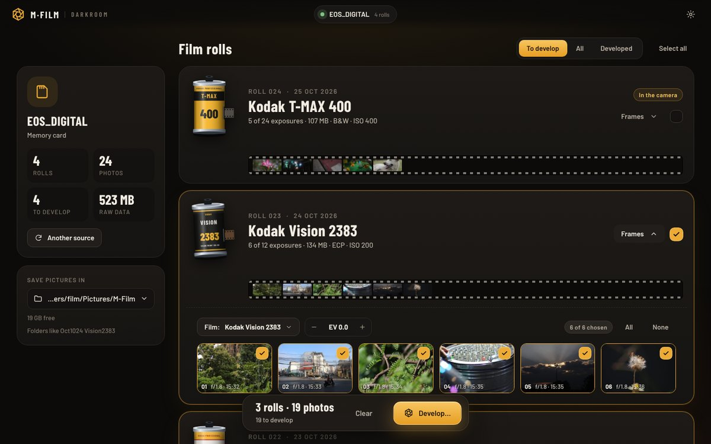</td>
<td width="50%">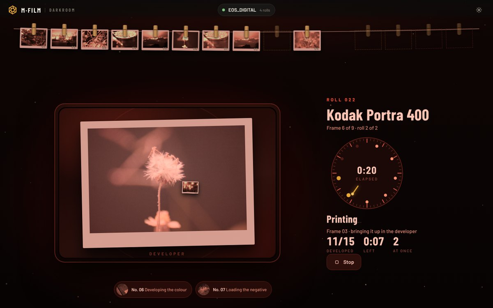</td>
</tr>
<tr>
<td><b>ม้วนของคุณ</b> แต่ละม้วนมีกลักฟิล์มและแถบรูปของม้วนนั้น ล้างทั้งม้วนหรือเลือกเฉพาะบางรูปก็ได้</td>
<td><b>ไฟแดงขึ้น</b> รูปออกมาจากถาดน้ำยาแล้วไปแขวนตากบนราว</td>
</tr>
<tr>
<td>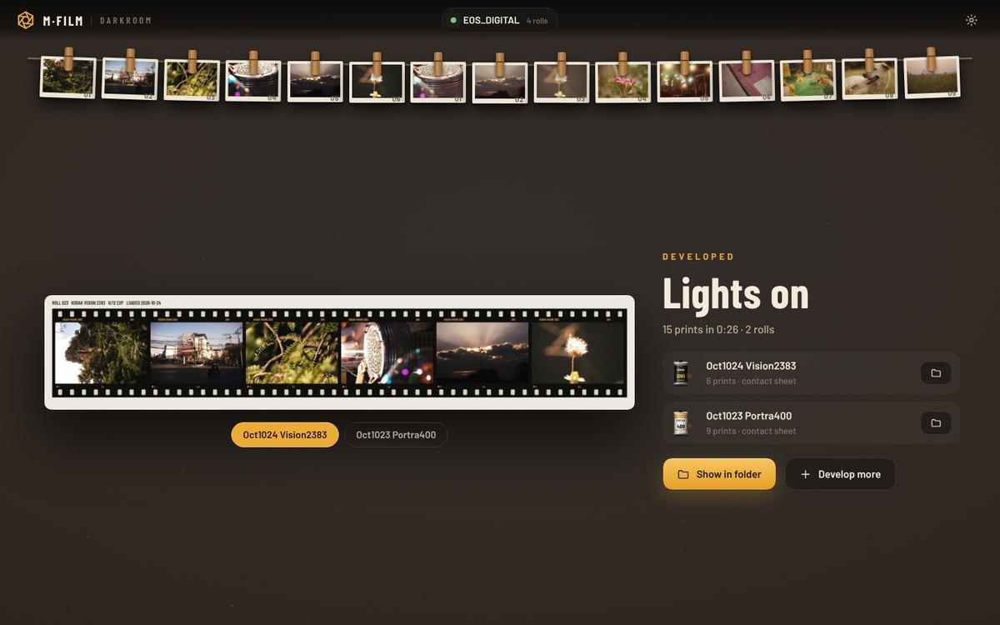</td>
<td>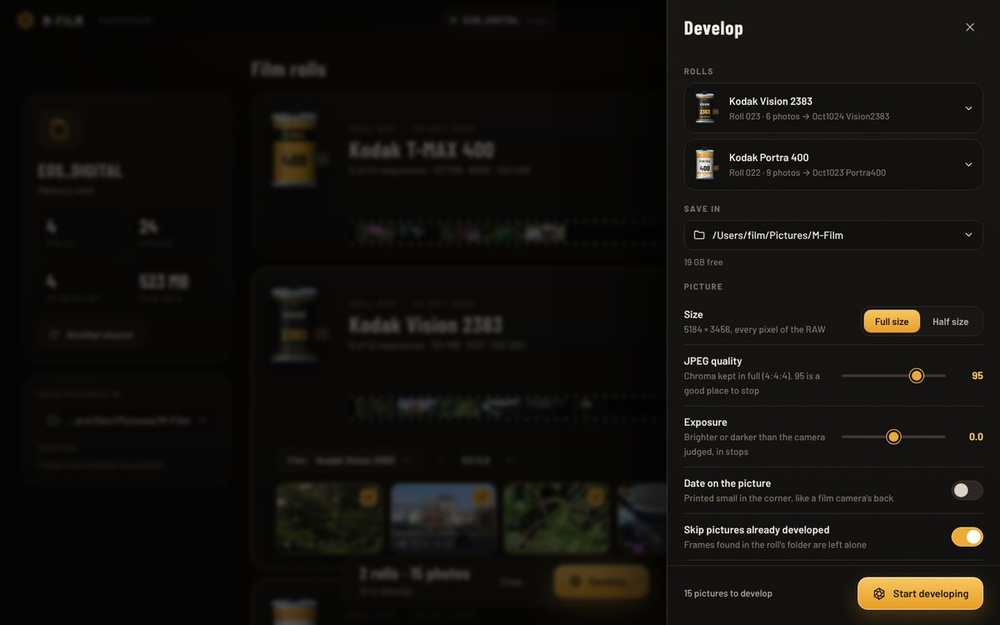</td>
</tr>
<tr>
<td><b>เปิดไฟ</b> ทุกม้วนได้ contact sheet และโฟลเดอร์ของตัวเอง</td>
<td><b>ละเอียดเต็มที่</b> ใช้ทุกพิกเซลของ RAW, JPEG สี 4:4:4, เก็บ EXIF ไว้ และใส่วันที่บนรูปได้</td>
</tr>
</table>

### ฟรี หรือ Full

| | ฟรี | Darkrooms Full |
|---|---|---|
| ล้างได้ต่อวัน | 1 ม้วน (ล้างม้วนเดิมซ้ำในวันเดียวกันไม่นับเพิ่ม) | ไม่จำกัด |
| ทุกฟิล์ม เต็มความละเอียด EXIF และ contact sheet | ✓ | ✓ |
| ล้างหลายม้วนพร้อมกันด้วยทุก core | | ✓ |
| ราคา | ฟรี | **US$5.99 จ่ายครั้งเดียว** อัปเดตฟรี |

ห้องมืดในกล้องยังฟรีและไม่จำกัดเหมือนเดิม ซื้อ Darkrooms Full ได้ในโปรแกรม (ไอคอนเฟือง → *Get Full*)
แล้ว key จะส่งมาทางอีเมล ใช้ได้ทีละ 1 เครื่อง (จะย้ายเครื่อง ให้กด Release ใน Darkrooms ที่เครื่องเดิมก่อน)

### ดาวน์โหลด

| คอมของคุณ | ไฟล์ | เปิดยังไง |
|---|---|---|
| **Windows 10 / 11** | `Darkrooms-windows-x64.zip` | แตกไฟล์ แล้วเปิด `Darkrooms.exe` ถ้า Windows เตือน: *More info* → *Run anyway* |
| **Mac ชิป Intel** | `Darkrooms-macos-intel.zip` | แตกไฟล์ ลากไปไว้ใน Applications แล้วเปิด ครั้งแรกไปที่ *System Settings → Privacy & Security → Open Anyway* (macOS 14 ลงไป: คลิกขวา → Open) |
| **Mac ชิป Apple silicon** | `Darkrooms-macos-apple-silicon.zip` | เหมือนกัน |

โหลดได้จาก **[release ของ Darkrooms](../../releases?q=Darkrooms&expanded=true)** (ตัวใหม่สุดอยู่บนสุด) ขนาดประมาณ 25–45 MB โปรแกรมยังไม่ได้ sign กับ Apple หรือ
Microsoft ครั้งแรกจึงมีคำเตือน

---

## ทำต่อยอด

- **มีกล้องรุ่นในตาราง?** [TESTING.md](TESTING.md): ลองแล้วบอกผล รุ่นนั้นจะได้ขึ้นเป็น ✅
- **กล้องรุ่นอื่น?** [PORTING.md](PORTING.md) บอกว่าส่วนไหนย้ายได้ง่าย (หน้าจอ Film OS)
  ส่วนไหนต้องทำใหม่ทุกรุ่น (ส่วนที่ต่อกับ Magic Lantern) และควรเริ่มยังไง
- **เจอปัญหา?** [แจ้งใน issues](../../issues/new/choose) แล้วแปะสิ่งที่ขึ้นในไอคอนเฟือง →
  *What does the computer see?*
- **ทุกหน้าจอ ทุกปุ่ม และวิธีทำงานข้างใน:** [คู่มือในกล้อง](docs/MANUAL.th.md)
- **ฟิล์ม** (ค่าฟิล์ม, รายการ LUT) อยู่ใน [`ml-dev/films/`](ml-dev/films/) build กล้องจะอบลงการ์ดให้
- **Darkrooms** โปรแกรมบนคอม เป็นโปรแกรมปิดซอร์ส ไม่ได้อยู่ใน repo นี้

## สนับสนุน

ส่วนในกล้องของ M-Film ใช้ฟรีและจะฟรีตลอดไป ถ้าได้ม้วนที่ชอบ
**[เลี้ยงกาแฟผู้พัฒนาได้ที่นี่ ☕](https://buy.stripe.com/7sY14p8d93QE5Ny5M58so02)**

## License

repo นี้ใช้ GPL-2.0 ([LICENSE](LICENSE)) เพราะส่วนในกล้องต่อยอดจาก Magic Lantern
Darkrooms (โปรแกรมบนคอม) เป็นโปรแกรมแยก ปิดซอร์ส ใช้สัญญาอนุญาตของตัวเอง ฟอนต์, LUT ของฟิล์ม และส่วนอื่นๆ:
[THIRD_PARTY.md](THIRD_PARTY.md) ไม่มีส่วนเกี่ยวข้องกับ Canon, Kodak, Fujifilm หรือผู้ผลิตฟิล์มรายใด
