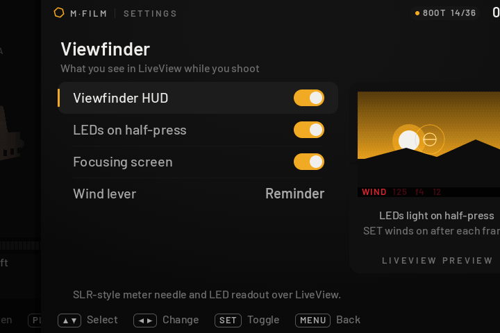
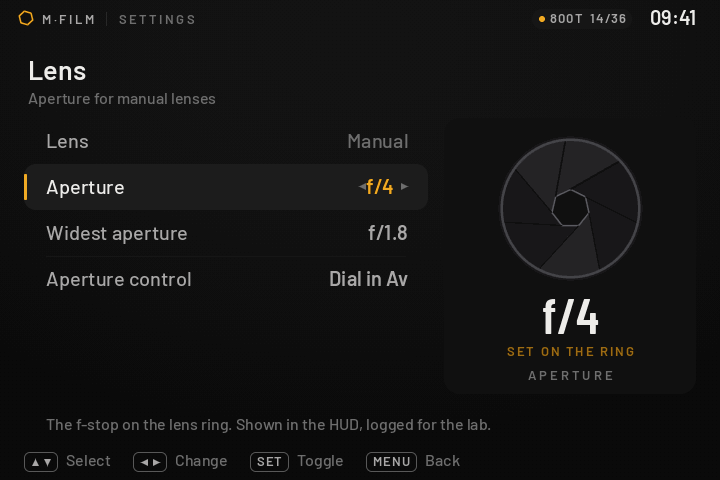
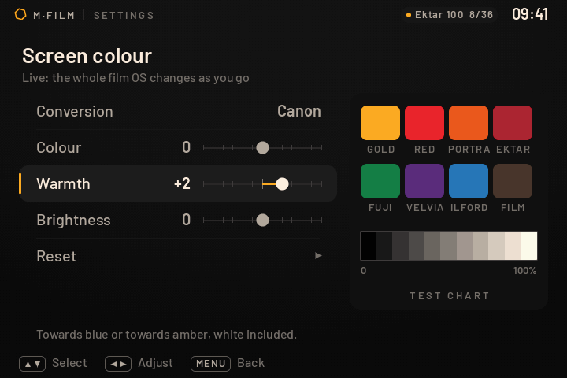
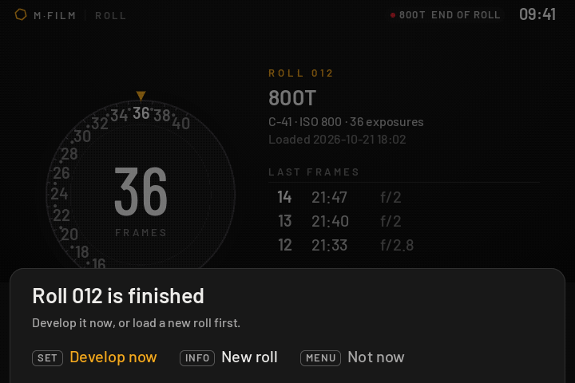
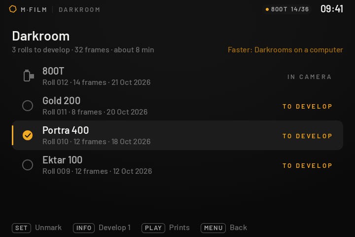
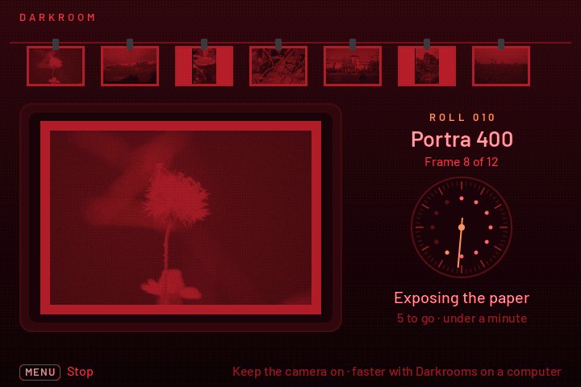
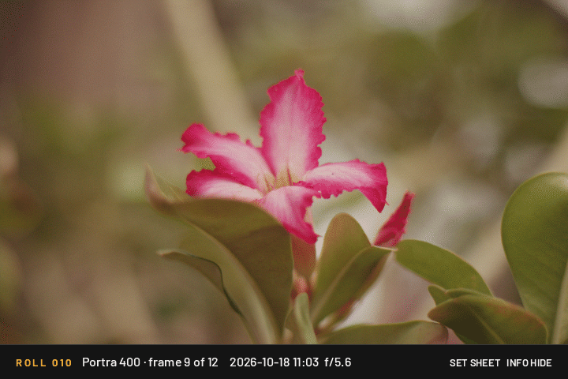

# คู่มือ M-Film ในกล้อง

[← หน้าแรก](../README.th.md) · [English](../README.md)

ทุกหน้าจอ ทุกปุ่ม และวิธีทำงานข้างใน เขียนจาก Canon EOS M ซึ่งเป็นกล้องที่ใช้ทำ M-Film
กล้องรุ่นอื่นหน้าจอเหมือนกัน แต่ปุ่มบางปุ่มอาจต่างไป (ดู [TESTING.md](../TESTING.md))

## หน้าจอในกล้อง

หน้าจอทั้งหมดในกล้องเป็นของ Film OS (M·FILM) ที่วาดเองทั้งหมด โดยมี Magic Lantern ทำงานอยู่ข้างใต้
ไม่มีเมนู ML แล้ว: อะไรก็ตามที่เคยเปิดเมนู ML (ปุ่ม, module, script) จะเปิด Home ของ Film OS แทน

| | |
|---|---|
|  |  |
| **ชั้นวางฟิล์ม** หน้าแรกตอนเปิดกล้อง กลักฟิล์มเป็นทรงกระบอกที่มีแสงเงา ฉลากพันรอบ ฝาโลหะ แกนม้วน หางฟิล์ม และรหัส DX ด้านหลัง เลื่อนแล้วกลักจะหมุนหันเข้าหากลาง | **Home** แทนเมนู ML: ม้วนที่อยู่ในกล้อง (กลักหมุนช้าๆ) และทางไปหน้าต่างๆ |
|  |  |
| **ตั้งค่า Viewfinder** ภาพตัวอย่างด้านขวาเปลี่ยนตามค่าที่ตั้ง | **ตั้งค่า Lens** ม่านรูรับแสงขยับตามค่า f ของเลนส์แมนนวล |
|  |  |
| **ม้วนฟิล์ม** หน้าปัดนับรูปแบบกล้องฟิล์ม หมุนจาก S ไปเลขรูปปัจจุบัน และกรอฟิล์มกลับได้ | **HUD ตอนถ่าย** แบบช่องมอง SLR: สเกลรูรับแสงกับเข็มวัดแสง และไฟ LED แดงแบบ 7 ส่วน |
|  | |
| **Screen colour** ปรับสีจอให้ตรงกับที่ตาเห็น พร้อมแผ่นเทียบสี | |

การโหลดฟิล์มจะดึงหางฟิล์มออกจากกลัก แล้วม่านชัตเตอร์ปิดและเปิดเข้าสู่ LiveView
ตอนเปิดกล้องมี animation ม่านรูรับแสงเปิดออก (ปิดได้ใน System)

### ฟิล์ม 72 ตัว บน 4 ชั้น
- ชั้นวางแยกตามชนิด: COLOUR (เนกาทีฟสี), SLIDE (สไลด์และ cross-process), B&W, CINE
  (CineStill และฟิล์มพิมพ์ภาพยนตร์) ▲ ▼ เปลี่ยนชั้น กลักของชั้นใหม่จะหล่นลงมา
- 8 ตัวแรก (Portra 400, CineStill 800T, Ektar 100, Gold 200, Superia 400, Velvia 50, HP5, Tri-X)
  สีมาจากโมเดลฟิล์มของ M-Film (`ml-dev/films/films.py`) อีก 63 ตัวมาจาก LUT ของ [Film-Luts](https://github.com/YahiaAngelo/Film-Luts)
  (Portra 160/800/NC/VC/UC, Pro 400H, Kodachrome, Ektachrome, Provia, Acros, T-MAX, Delta,
  Vision 2383 ฯลฯ) และ CineStill 400T จาก LUT ส่วนตัว (`ml-dev/films/luts/cinestill400t.slog3.cube`)
- ข้อมูลฟิล์มเหล่านี้อยู่ในไฟล์ `ML/DATA/FOSFILMS.BIN` บนการ์ด (ไม่ได้อยู่ใน autoexec.bin
  ที่ต้องเล็ก) ฉลากกลักวาดจากส่วนประกอบตามยี่ห้อ (`ml-dev/filmos/tools/catalog.py`)
- ตารางสีของทุกฟิล์ม (`ML/DARKROOM/LOOKnn.LUT`) อบมาจาก LUT ตอน build
  แบบเดียวกับที่ Darkrooms บนคอมใช้ (`tools/genfilms.py`) กล้องจึงไม่ต้องสร้างเอง
- รูปตัวอย่าง (PLAY บนชั้นวาง): รูปเดียว (`ml-dev/films/sample/SAMPLE.CR2`) ล้างด้วยทุกฟิล์มตอน build
  ด้วยตัวล้างและตารางสีเดียวกับในกล้อง ได้ `ML/SAMPLES/Fnnn.BMP` (ฟิล์มละไฟล์ ราว 26 MB ทั้งหมด)
  ทุกรุ่นได้ชุดเดียวกัน (รวม build ที่ไม่มีห้องมืด) เปลี่ยนรูปได้โดยวาง CR2 จาก EOS M ไฟล์ใหม่แทนแล้ว build ใหม่

### สนับสนุน
System > Support M·FILM แสดง QR code ของลิงก์โดเนท (สูงสุด 2 อัน) ใส่ลิงก์ใน `ml-dev/donate.txt`
บรรทัดละ `ชื่อ URL` แล้ว build ใหม่ (`tools/genqr.py`, ต้องมี `pip install segno`)
ไม่มีลิงก์ หน้านี้จะขึ้นคำขอบคุณแทน

### ห้องมืด: ล้างฟิล์มในกล้อง

| | |
|---|---|
|  |  |
| **ถ่ายครบม้วน** กล้องถามเอง: ล้างเลย (SET) หรือใส่ม้วนใหม่ก่อน (INFO) | **Darkroom** ม้วนที่ยังไม่ล้าง / ล้างแล้ว / ยังอยู่ในกล้อง เลือกบางม้วน (SET) หรือล้างทั้งหมด (INFO) |
|  |  |
| **กำลังล้าง** ใต้ไฟแดง: ภาพแฝงค่อยๆ ขึ้นบนกระดาษในถาดน้ำยาตามที่ CPU อ่าน RAW ได้ แล้วภาพเข้มขึ้นจนเต็ม | ภาพที่เสร็จแล้วถูกยกขึ้นไปตากบนราว นาฬิกาจับเวลาห้องมืดเดินรอบละรูป จุดรอบหน้าปัดคือรูปทั้งม้วน |
|  |  |
| **Prints** contact sheet ของม้วน (PLAY เปิดหน้านี้) | ดูทีละรูปเต็มจอ ด้วยสีของรูปนั้นเอง |

- ระหว่างม้วน **ไม่ให้เห็นภาพ**: PLAY เปิด Prints (เฉพาะรูปที่ล้างแล้ว) แทน playback ของ Canon
  (ปิดได้ที่ System > PLAY shows prints only) ตั้งในเมนู Canon เองครั้งเดียว: Image quality = RAW
  และ Image review = Off (ถ้ายังไม่ได้ตั้ง กล้องจะขึ้นข้อความเตือนตอนโหลดม้วน; ML ไม่เปลี่ยนค่าพวกนี้เอง
  เพราะการเขียนค่า quality ของ Canon โดยตรงเสี่ยงทำให้เฟิร์มแวร์รวน)
- ถ่ายครบม้วน กล้องจะเปิดหน้าถามเองหลังรูปสุดท้าย ~1.5 วินาที (หรือกด SET ตอนม้วนหมด)
  กรอกลับกลางม้วนที่หน้า Roll ก็ถามแบบเดียวกัน
- ล้างด้วย CPU ของกล้องเอง (`fos_dev.c`): อ่าน CR2 ถอดรหัส lossless JPEG ทีละส่วน
  รวมพิกเซลลงภาพขนาดจอ 720×480 โดยตรง แล้วทำแบบเดียวกับ Darkrooms บนคอม:
  WB daylight, สีกล้อง → sRGB, การวัดแสงของเครื่องสแกน, balance ของฟิล์ม, vignette, halation,
  สีของฟิล์ม (ตาราง 3D จากโมเดลเดียวกับ Darkrooms) และเกรน แล้วลดเหลือ 240 สีพร้อม dithering
  สีที่ได้ต่างจาก Darkrooms บนคอมเฉลี่ย ~4 ระดับจาก 255 (ตรวจด้วย color chart)
- ความเร็ว: ~0.63 พันล้านคำสั่ง ARM ต่อรูป (วัดด้วย qemu บน CR2 จริงของ EOS M; เดิม ~1.3 พันล้าน
  และอีก ~0.55 พันล้านตอนใช้ฟิล์มตัวนั้นครั้งแรก) ประมาณ 15 วินาทีต่อรูปบนกล้อง
  ดูเวลาจริงได้ใน `ML/FILMROLL.LOG` (บรรทัด `developed in N ms`) กล้องจะไม่ดับเองระหว่างล้าง
  - ตัวถอดรหัสอ่านทีละคู่ของค่า โดยค่าที่ใช้อยู่เก็บใน register ทั้งหมด ไบต์ 0xFF หาล่วงหน้าทีละ 16 ไบต์
    แล้วรวมค่าลงพิกเซลของภาพทีละ 2 ค่า (word เดียว)
  - ระหว่างล้าง หน้าจอวาดแค่เข็มนาฬิกา ~4 ครั้งต่อวินาที เวลาที่เหลือให้การล้างเกือบทั้งหมด
    (ตอนรูปโผล่ในถาดหรือแขวนตาก หน้าจอจึงกลับมาลื่นตามปกติ)
  - ตารางสีของทุกฟิล์ม (`ML/DARKROOM/LOOKnn.LUT`) สร้างมาจากตอน build และติดตั้งลงการ์ดด้วย
    กล้องจึงไม่ต้อง "ผสมน้ำยา" เอง (ถ้าโมเดลสีเปลี่ยน กล้องจะสร้างใหม่และเก็บไว้เอง)
- หยุดกลางคันได้ (MENU) หรือกดชัตเตอร์ครึ่งเดียวกลับไปถ่าย: รูปที่ล้างเสร็จแล้วยังอยู่
  ครั้งหน้าจะล้างต่อจากรูปที่ค้าง
- รูปที่ล้างแล้วเป็น JPEG สีเต็ม (720×480, มี EXIF วันที่ ฟิล์ม และค่า f) อยู่ใน DCIM
  โฟลเดอร์ละม้วน ตั้งชื่อตามวันที่ถ่ายรูปแรกและฟิล์ม: `DCIM/Sep0906 Portra400/IMG_0102.JPG`
  (เดือนย่อ, เลขเดือน, วันที่) ม้วนที่สองของฟิล์มเดียวกันในวันเดียวกันเป็น `Sep0906 Portra400 2`
  ถ้าการ์ดสร้างชื่อยาวไม่ได้ จะเป็น `SEP0906` แทน (log: `darkroom: JPEGs in ...`)
  ม้วนที่มี JPEG ไม่ครบทุกรูป (เช่นล้างไว้ก่อนมีฟีเจอร์นี้) จะกลับมาเป็น TO DEVELOP
  ล้างอีกครั้งจะทำเฉพาะรูปที่ยังไม่มี JPEG
- สำหรับดูในกล้องยังมี `ML/DARKROOM/R<ม้วน>/F<รูป>.BMP` (240 สี) และ `SHEET.BMP` (contact sheet)
  ม้วนถือว่าล้างแล้วเมื่อมี `SHEET.BMP` ไฟล์ CR2 เดิมยังอยู่ครบ เอาไปล้างละเอียดเต็มขนาดด้วย Darkrooms บนคอมได้เหมือนเดิม

### สีบนจอ
สีของ Film OS ส่งไปที่จอแบบเดียวกับที่ Canon แปลงสีของตัวเอง (BT.601 Y'CbCr, ขาวที่ระดับ 235)
ตรวจกับค่าพาเลตจริงที่อ่านจาก EOS M แล้ว: แปลงกลับเป็นสีหลักได้เป๊ะ เช่นแดงเข้ม (202, 0, 0)
ถ้ายังไม่ตรงกับที่ตาเห็น ปรับได้ที่ System > Screen colour: Colour (ความสด), Warmth (อุ่น/เย็น),
Brightness (โทนกลาง) และ Conversion (Canon / Rec.709 แบบเดิม) ทั้งระบบเปลี่ยนทันทีขณะปรับ
ด้านขวามีแผ่นเทียบสี: สีฉลากฟิล์ม และแถบเทา 11 ขั้น (สองขั้นที่มืดที่สุดควรยังแยกกันออก)

### ปุ่ม

| ที่ไหน | ปุ่ม | ทำอะไร |
|---|---|---|
| ตอนถ่าย (LiveView) | แตะจอสองนิ้ว หรือกด ▼ ค้าง | เปิด Home (ปุ่มที่เคยเปิดเมนู ML) |
| | PLAY | เปิด Prints: เฉพาะรูปที่ล้างแล้ว (ไม่มี playback ของ Canon) |
| | SET | กรอฟิล์มไปรูปถัดไป ถ้าม้วนหมดจะถามว่าจะล้างเลยไหม |
| | หมุนวงล้อในโหมด Av | ตั้งค่า f ของเลนส์แมนนวล |
| ชั้นวางฟิล์ม | หมุนวงล้อ / ◀ ▶ | เลือกฟิล์ม |
| | ▲ ▼ | เปลี่ยนชั้น: COLOUR / SLIDE / B&W / CINE |
| | INFO | จำนวนรูป 36 / 24 / 12 |
| | SET | โหลดม้วน (ถ้ามีม้วนค้างอยู่ จะถามก่อนกรอกลับ) |
| | PLAY | ดูรูปตัวอย่างของฟิล์มนั้นเต็มจอ (เฉพาะ EOS M) |
| รูปตัวอย่าง | ◀ ▶ / หมุนวงล้อ | ฟิล์มก่อนหน้า / ถัดไปบนชั้นเดียวกัน |
| | SET | โหลดม้วนฟิล์มที่ดูอยู่ |
| | INFO | แสดง/ซ่อนแถบชื่อฟิล์ม |
| | PLAY / MENU | กลับไปชั้นวาง ที่ฟิล์มที่ดูอยู่ |
| Home | ▲ ▼ / หมุนวงล้อ, SET | เลือก, เปิด (PLAY = Prints) |
| Darkroom | SET | ทำเครื่องหมายม้วนที่จะล้าง / เปิด Prints ของม้วนที่ล้างแล้ว |
| | INFO | ล้างม้วนที่เลือก (ไม่ได้เลือก = ล้างทั้งหมด) |
| กำลังล้าง | MENU | หยุด (รูปที่เสร็จแล้วยังอยู่) |
| Prints | ◀ ▶ ▲ ▼, SET | เลือกรูปใน contact sheet, เปิดเต็มจอ |
| | หมุนวงล้อ | ม้วนอื่น (ใน contact sheet) / รูปถัดไป (เต็มจอ) |
| | INFO | แสดง/ซ่อนรายละเอียด (ม้วน, วันเวลา, f) |
| หน้าตั้งค่า | ▲ ▼ / หมุนวงล้อ | เลือกแถว |
| | ◀ ▶ | เปลี่ยนค่า |
| | SET | เปิด/ปิด หรือทำคำสั่ง |
| Screen colour | ◀ ▶ | ปรับค่า (เห็นผลทันที) |
| ทุกหน้า | MENU | ย้อนกลับ |
| | ชัตเตอร์ครึ่งเดียว | กลับไปถ่ายทันที |

เมนูของ Canon (ฟอร์แมตการ์ด, RAW) อยู่ที่ System > Canon menu หรือกด MENU ตอนถ่ายตามปกติ
ค่าของ ML ที่ไม่มีใน Film OS จะเป็นค่าเริ่มต้นของ ML เสมอ
(ถ้าจำเป็นต้องใช้เมนู ML จริงๆ ให้คืน ML ทางการด้วย `restore_official.ps1`)

ถ้าเปิด Debug log ไว้ ตอนปิด Film OS จะเขียนสรุปความเร็วลง `ML/FILMROLL.LOG` บรรทัดเดียว
(`film os: N frames in N ms = N/s; per frame N ms draw (N canisters) + N present + N rest, worst N, open N ms`)
ไม่เขียนการ์ดระหว่าง animation
และถ้ากล้องวาดไม่ทัน Film OS จะลดรายละเอียดกลักฟิล์มเองอัตโนมัติ
ถ้ามีปัญหาให้คืน ML ทางการด้วย `restore_official.ps1`

ความเร็ว: ทุกหน้าจอวัดจากโค้ดที่ compile สำหรับ ARMv5 (ชิปเดียวกับกล้อง) ด้วย qemu
(`sim/tools/armcount.py`) แล้ววาดเฉพาะส่วนที่ขยับ ตรวจแล้วว่าภาพตรงกับการวาดทั้งจอทุกพิกเซล
(`FOS_FULL=1 ./out/sim ...`)

สิ่งที่ควรลองบนกล้องครั้งแรก
1. เปิดกล้อง: ม่านรูรับแสงเปิดออก แล้วเข้าชั้นวางฟิล์ม สีตรงกับภาพตัวอย่างไหม (ไม่ตรง: System > Screen colour)
2. หมุนวงล้อเร็วๆ: ลื่นไหม (ดูบรรทัด `film os: N frames/s` ใน `ML/FILMROLL.LOG` หลังปิด Film OS)
3. SET โหลดม้วน: กลับเข้า LiveView แล้ว picture style / WB / ISO เปลี่ยนตามฟิล์ม
4. แตะจอสองนิ้ว (หรือกด ▼ ค้าง) ตอนถ่าย: เปิด Home และไม่มีเมนู ML ขึ้นมาเลย
5. กดชัตเตอร์ครึ่งเดียวตอนอยู่ในหน้าไหนก็ได้: กลับไปถ่ายทันที
6. ถ่ายสักสองสามรูป: HUD นับรูป และหน้า Roll แสดงรูปล่าสุด ไม่มีภาพขึ้นหลังถ่าย และ PLAY ไม่โชว์รูป
7. ห้องมืด: ใส่ม้วน 12 รูป ถ่ายให้ครบ แล้วเลือก "ล้างเลย" ดูว่าภาพแฝงขึ้น ภาพไปตากบนราว และดูเวลาที่ใช้ต่อรูป
   (`darkroom: roll ... frame N developed in N ms` ใน `ML/FILMROLL.LOG`) แล้วกด PLAY ดู Prints
   ถ้ารูปไหนล้างไม่ได้ เหตุผลจะอยู่ใน log บรรทัด `darkroom: roll ... frame N: ...`

### โค้ด
- `ml-dev/filmos/` Film OS (C ล้วน ใช้ได้ทั้งในกล้องและบนคอม)
  - `fos_gfx.c` ระบบวาดภาพ: palette 254 สีแบบไล่เฉด (ramp) กับ dithering, รูปทรงขอบเนียน, ตัวอักษร
  - `fos_film.c` ข้อมูลฟิล์มแต่ละตัว และการวาดกลักฟิล์ม 3D กับลายฉลาก
  - `fos_ui.c` ลูปหลัก, animation แบบสปริง, การเปลี่ยนหน้า, ม่านชัตเตอร์
  - `fos_shelf.c` ชั้นวางฟิล์มและการโหลดม้วน, `fos_pages.c` Home, ตั้งค่า, ม้วนฟิล์ม
  - `fos_hud.c` HUD ตอนถ่าย (ใช้ palette ของ Canon)
  - `fos_dev.c` เครื่องล้างฟิล์ม: อ่าน CR2, ถอดรหัส RAW, สีฟิล์ม, ลดสี, เขียนภาพ BMP
  - `fos_looks.c` ค่าฟิล์มแต่ละตัวสำหรับกล้อง สร้างจาก `ml-dev/films/films.py` ด้วย `tools/genlooks.py` (อย่าแก้เอง)
  - `fos_lab.c` อ่าน log ของม้วนบนการ์ด และสถานะการล้าง, `fos_dark.c` หน้า Darkroom, กำลังล้าง, Prints
  - `fos_font.c` ฟอนต์ที่สร้างจาก `tools/mkfont.py` (Barlow, `fonts/`) ไม่ได้ build เข้า autoexec.bin:
    `tools/fontblob.c` แปลงเป็น `ML/DATA/FOSFONT.BIN` ที่กล้องโหลดจากการ์ด
  - `sim/` ตัวจำลองบนคอม, `preview/` ภาพตัวอย่าง
- `ml-dev/fork/src/filmroll.c` ส่วนเชื่อมกับกล้อง: ม้วนฟิล์ม, log, ตั้งค่ากล้องตามฟิล์ม,
  การยึดหน้าจอและปุ่มให้ Film OS, palette
- `ml-dev/fork/apply_fork.py` และ `fork/film-mode.patch` การแก้ไขบน
  [magiclantern_simplified](https://github.com/reticulatedpines/magiclantern_simplified)
  commit `ed3e7c0df` (ตรงกับ build ทางการ 2025-06-20.EOSM.202)
- `setup_wsl.sh` ตั้งเครื่อง build ใน WSL Ubuntu
- `build_fork.sh` build fork แล้วเก็บไฟล์สำหรับลงการ์ดไว้ที่ `ml-dev/out/fork/`
- `install_fork.ps1` / `restore_official.ps1` ลง fork บนการ์ด / คืน ML ทางการ
- `push_fork.ps1` push branch `film-mode` ของ fork ทั้งชุดขึ้น
  [HNGSeries/magiclantern-eosm-film](https://github.com/HNGSeries/magiclantern-eosm-film) (private)
- `filmroll/` โหมดฟิล์มรุ่นแรกที่ทำเป็น ML module (เก็บไว้อ้างอิง ไม่ได้ใช้แล้ว)

กล้องต้องใช้เฟิร์มแวร์ 2.0.2

**ขนาดของ autoexec.bin สำคัญ:** บน EOS M หน่วยความจำของ ML ทั้งหมด (โค้ด + bss) ถูกตัดมาจากหน่วยความจำของ Canon ตอนบูต
ถ้าใหญ่เกินไปกล้องจะค้างตอนเปิด (ไฟการ์ดสีแดงติดค้าง เปิดไม่ขึ้น) `build_fork.sh` จึงหยุดถ้าเกิน 727,072 ไบต์
(ขนาดใหญ่สุดที่เคยเปิดได้) ฟอนต์ของ Film OS จึงอยู่ในไฟล์ `ML/DATA/FOSFONT.BIN` บนการ์ด (`tools/fontblob.c`)
โหลดหลังบูต และตารางของห้องมืดจองหน่วยความจำเฉพาะตอนเปิด Film OS
ถ้ากล้องค้างแบบนั้น: ถอดแบต ถอดการ์ด เปิดกล้องได้ตามปกติ แล้วคืน ML ทางการด้วย `restore_official.ps1`

### ตัวจำลอง
```
cd ml-dev/filmos/sim
make
./out/sim scenes/shelf.txt out/frames/shelf        # กดปุ่มตามสคริปต์ เก็บทุกเฟรม
python3 topng.py --gif out/shelf.gif out/frames/shelf/*.idx
./previews.sh                                       # สร้างภาพใน ../preview ใหม่
```
สคริปต์ใน `scenes/` เป็นบรรทัด `<ms> <ปุ่ม>` (left right up down wl wr set menu info play home)

ห้องมืดในตัวจำลองใช้การ์ดจำลองที่ `sim/out/card/` (`./mkcard.sh` สร้างม้วนจาก CR2 ทดสอบ)
```
./mkcard.sh && ./out/sim scenes/darkroom.txt out/frames/darkroom
make out/devtest && ./out/devtest -f portra400 IMG_0001.CR2 out.BMP out.ppm   # ล้างรูปเดียวแบบที่กล้องทำ
```
`tools/mkcr2.c` สร้าง CR2 ทดสอบแบบของ EOS M (ตรวจกับ LibRaw แล้ว), `devtest -r` เทียบค่าที่ถอดรหัสได้ทุก sample
แก้ฟอนต์หรือขนาดตัวอักษรที่ `tools/mkfont.py` แล้วรัน `python3 mkfont.py` (ต้องมี Pillow กับ raqm)

## ฟิล์ม (`ml-dev/films/`)
ค่าฟิล์มที่ทั้งกล้องและ Darkrooms ใช้ build กล้องจะอ่านจากที่นี่
- `films.py` ค่าของฟิล์มแต่ละตัว ตั้งด้วยสายตา ยังไม่ได้วัดเทียบกับฟิล์มจริง
- `filmluts.py` ฟิล์ม 63 ตัวที่สีมาจาก Film-Luts, `getluts.py` ดาวน์โหลด LUT เหล่านั้นไว้ที่
  `luts/filmluts/` (ไม่ได้เก็บใน git) ตอน build กล้องจะอบเป็นตารางสีลงการ์ด
- `lut.py` อ่านและใช้ไฟล์ `.cube` (`python lut.py info ไฟล์.cube` ดูว่าใน LUT มีอะไร)
- CineStill 400T ใช้ LUT ส่วนตัว: วางไว้ที่ `luts/cinestill400t.slog3.cube`
